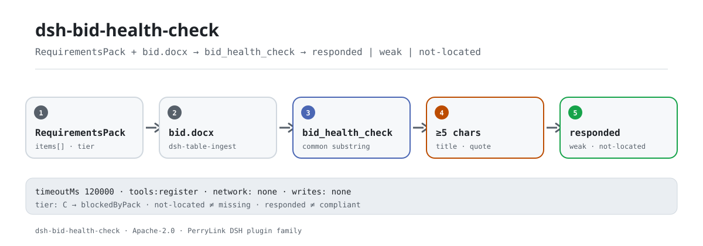

<div align="center">

<picture>
  <source media="(prefers-color-scheme: dark)" srcset="docs/assets/dsh-bid-health-check-flow-dark.svg">
  
</picture>

# dsh-bid-health-check

**Match a bid back to its requirements, item by item — what looks answered, what is weak, and what could not be located, in one pass.**

A purely local checker for bid writers and proposal teams: it reads a `RequirementsPack` and a `.docx`, reports three word-level states, and makes no compliance, liability, or replacement-for-a-reviewer claim.

[Install](#three-step-setup) · [Configuration](#configuration) · [FAQ](#faq) · [简体中文](README.md) · [English](README.en.md) · [Español](README.es.md) · [Português](README.pt.md) · [हिन्दी](README.hi.md)

[](LICENSE)
[](#compatibility)
[](https://www.npmjs.com/package/dsh-bid-health-check)
[](https://github.com/PerryLink/dsh-bid-health-check/actions/workflows/ci.yml)
[](#compatibility)

[](https://github.com/PerryLink/dsh-bid-health-check/stargazers)
[](https://www.npmjs.com/package/dsh-bid-health-check)
[](https://dshfind.com/plugins/PerryLink/dsh-bid-health-check?ref=badge)
[](https://securityscorecards.dev/viewer/?uri=github.com/PerryLink/dsh-bid-health-check)

```sh
dsh plugin --profile <name> add dsh-bid-health-check
```

</div>

<sub>Community plugin, not affiliated with DeepSeek. Canonical repository: <https://github.com/PerryLink/dsh-bid-health-check>.</sub>

## What it is

`dsh-bid-health-check` reads a `RequirementsPack` (produced by `dsh-tender-requirements`) and a bid document `.docx`, then reports — requirement by requirement — where the bid appears to answer, where the match is weak, and where nothing could be located.

The honest form of that question is much narrower than "is the bid complete": the tool can locate a paragraph that appears to answer a requirement, or fail to locate one. It cannot know whether the located paragraph actually satisfies the requirement, and it certainly cannot conclude that an unlocated requirement is unanswered. The report keeps "not located" in its own group and states that distinction first — treating "not located" as "missing" is how a bidder comes to rewrite a section that was already there, in a table, an appendix, or different wording.

There are exactly two inputs: the requirements list `pack` (JSON, or YAML with an `items` array) and the bid `file` (`.docx`). Paragraphs are read by `dsh-table-ingest`; tables inside the bid are not read by this version.

## Three-step setup

1. **Install** (pick one channel):

   ```sh
   # git channel (latest main; the prepare script builds lib/)
   dsh plugin --profile web add github:PerryLink/dsh-bid-health-check
   # npm channel (published release, ships lib/)
   dsh plugin --profile web add dsh-bid-health-check
   # tarball channel: after pnpm run build && pnpm pack in this repo
   dsh plugin --profile web add ./dsh-bid-health-check-<version>.tgz
   ```

2. **Minimal config** (defaults work; tune the timeout only if needed):

   ```yaml
   - insert:
       - id: dsh-bid-health-check
         name: dsh-bid-health-check
         config:
           timeoutMs: 120000
   ```

   The rule pack is resolved from the package at `rules/bid-health-check.yaml`; it is not a configuration key. `timeoutMs` is the only runtime setting today.

3. **Verify it mounts**:

   ```sh
   dsh --profile web --dump-config | grep 'dsh-bid-health-check'
   node samples/quickstart/run.mjs --check
   ```

   ```text
   bid_health_check: quickstart OK — output matches expected/result.json
   ```

   Expected result from [`samples/quickstart/expected/result.json`](samples/quickstart/expected/result.json): 2 `responded`, 3 `weak`, 6 `not-located`, plus 1 blocked on the tender side. First-run screenshot: [`docs/assets/quickstart.png`](docs/assets/quickstart.png); run log: [`docs/assets/quickstart.log`](docs/assets/quickstart.log).

**Uninstall**: `dsh plugin --profile web remove dsh-bid-health-check` (or remove the row from the profile patch).

## Core capabilities

`dsh-bid-health-check` does **word-level location between the requirements list and the bid**, and puts every requirement into one of three states:

- **Three states, and the third is not "missing"** — `responded` / `weak` / `not-located`. `not-located` means only that the tool did not find it; the report says, in as many words, that the bid may answer in a table, an appendix, or different wording.
- **A five-character overlap gate** — a title must share a longest common substring of at least five characters with a bid paragraph to count. Four is too loose (a "bid deadline" requirement matched on "bid").
- **Quote-only overlaps degrade** — when the title overlap is under four characters the tool falls back to the requirement's quote; a quote-only overlap of six characters or more caps at `weak`, because sharing text with the clause that contains a requirement is not evidence the requirement is met.
- **Ties go to the longer paragraph** — a heading such as "Chapter 3 — Bid Security" repeats the label, while the body states the amount.
- **A heading is not a response** — a match that is only a short heading (at most 12 characters and no sentence punctuation) drops to `weak`.
- **Rejection clauses cap at `weak`** — a rejection clause is a condition the bidder must meet, not a sentence to answer; no bid says "we agree to be rejected", so such a clause is never scored `responded`.
- **Queue C passes through** — a requirement the tender side could not extract reliably is reported as blocked by the `RequirementsPack` (`blockedByPack`), not graded against the bidder.
- **An empty pack is refused** — `items: []` raises an error; an empty list would make every bid look like it answers nothing.
- **Purely local** — no network, no model call, no file writes; it reads only the `pack` and `file` paths it is given.

### What it answers

- Which requirements have a bid paragraph that plausibly answers them?
- Which matches are only a shared phrase, and therefore need a person to look?
- Which requirements have no located response, so a human can check them by hand?
- Which requirements cannot be checked at all because the tender side is still unresolved?

### How matching works

For each requirement the tool measures the longest common substring between its title and every bid paragraph; when the title overlap is under four characters it falls back to the requirement's quote. A match counts only at five characters or more, and a tie goes to the longer paragraph. Quote-only matches of six characters or more cap at `weak`, heading matches drop to `weak`, and the `reject-clause` category caps at `weak` too. The matched paragraph ordinal, an excerpt, and the overlap length all go into the report, so the reader can judge whether the paragraph is evidence.

## Configuration

Every tunable is a Schemastery `Config` field (overridable from `cordis.yml`). There is one key today:

| Key | Default | Meaning |
|---|---|---|
| `timeoutMs` | `120000` | Tool execution timeout budget in milliseconds; the DSH tool layer aborts on expiry |

<details>
<summary>Full configuration table (1 key)</summary>

| Key | Default | Meaning |
|---|---|---|
| `timeoutMs` | `120000` | Tool execution timeout budget in milliseconds; the DSH tool layer aborts on expiry |

</details>

The rule pack is always resolved from the package at `rules/bid-health-check.yaml` (tooling locates `rules/<pack>.yaml`); it is not a configuration key. This package's `rules` list is empty — it is a consumer, not a checker; it cites no clause as the basis of a finding and makes no compliance determination.

Example override in your profile patch:

```yaml
- insert:
    - id: dsh-bid-health-check
      name: dsh-bid-health-check
      config:
        timeoutMs: 180000
```

## FAQ

<details>
<summary>Does it upload the bid? Where does the data live?</summary>

Purely local. The tool reads only the `pack` and `file` paths it is given; it makes no network request, calls no model, writes no file, and builds no index. `package.json#dsh.demo` also declares `network: false` and `writes: []`. Note that the report quotes up to 200 characters from matched paragraphs, so the report itself should be handled at the bid's sensitivity level.

</details>

<details>
<summary>Does "not located" mean the requirement was not answered?</summary>

No. The requirement may be answered in a table, an appendix, a scanned page, or different words; this tool reads only `.docx` paragraphs, so "not located" means only that this run did not find it. The report states that sentence before the results and groups these requirements separately for manual review.

</details>

<details>
<summary>Does "responded" mean the requirement is satisfied?</summary>

No. The tool returns a paragraph that appears to respond, plus its position and overlap length; whether it actually satisfies the requirement is for a person to read and decide. Rejection clauses are stricter still: they are conditions to meet, not sentences to answer, so they cap at `weak`.

</details>

<details>
<summary>Does it fight other plugins over tool names, events, or services?</summary>

No. It registers exactly one tool, `bid_health_check`, and declares `inject: ['tools']`; it provides no service key, registers no command, no client slot, no `webServer` prefix, listens to no shared event, and mutates no globals. The bundle patch only `insert`s its own row. The point-by-point argument is in "Interoperability with other DSH plugins".

</details>

<details>
<summary>How big is the performance overhead? Is there a benchmark?</summary>

Pure string comparison — no network requests, no model calls — with cost roughly proportional to requirements × paragraphs × paragraph length (longest common substring). This repository publishes no benchmark, so no accuracy/recall figures are claimed here; the 11 requirements in `samples/quickstart` can be re-run directly, and `timeoutMs` bounds the run.

</details>

<details>
<summary>The plugin installs but the tool never appears, or the result is empty. What now?</summary>

First check that `main` resolves to `lib/index.mjs` and that `pnpm run build` produced it; `dsh --profile <name> --dump-config | grep 'dsh-bid-health-check'` should show the row; outside the peer range, grant an explicit exemption. If no check ran or the result is empty, read `warnings` and `blockedByPack` in the report; an empty `items` list is rejected outright rather than presented as "everything passed".

</details>

## Security boundaries

- **No compliance determination.** The report lists only differences and location results it can point to inside the material; it makes no compliance, legal, liability, or rejection verdict.
- **Not located ≠ not written.** This is the tool's most important boundary: it reports "not found this time" and does not infer "missing".
- **Responded ≠ satisfied.** A matched paragraph is a pointer for a human; whether it satisfies the requirement is a human judgement.
- **Reads two local files only.** No network, no model call, no writes; the caller supplies both paths and the tool does not scan directories.
- **The report contains source excerpts.** Up to 200 characters of a matched paragraph enter the report; treat the report with the same sensitivity as the bid.
- **Fail loud.** An empty `items` list, invalid JSON, a missing entry `id`, or a missing `pack`/`file` argument raises an error instead of returning an empty result that could be read as "everything passed".

## Known limitations

- **Paragraphs only.** Paragraphs come from `dsh-table-ingest`; this version does not read tables, scanned pages, or attachments in the bid, so responses there are not counted at all.
- **Word-level matching, no paraphrase understanding.** A response written in different words is reported as `not-located`; conversely, a shared phrase can produce a false hit, which is why `weak` needs a human look.
- **The five-character gate is empirical.** A requirement whose title is itself shorter than five characters may never match; longer titles are more stable but still need confirmation.
- **The quote-only five-character edge.** In the current implementation a quote-only overlap of exactly five characters can still be scored `responded` (`src/model.ts:249`); treat items on that edge as pointers and review them by hand.
- **A located paragraph is a pointer, not a verdict.** The report gives the paragraph ordinal, an excerpt, and the overlap length; it does not decide whether the requirement is met.
- **Queue C cannot be checked.** A requirement unresolved on the tender side is reported only as `blockedByPack`, never graded against the bidder.
- **`.docx` only.** `file` must be a `.docx`; PDFs and scans are out of scope for this version.
- **An empty pack is refused.** A missing `items` or `items: []` raises an error.
- **No public benchmark.** No accuracy/recall numbers are claimed; the sample only verifies the pipeline and the three-state counts.

## Interoperability with other DSH plugins

This plugin does one thing: register the `bid_health_check` tool. `src/index.ts` declares `inject: ['tools']`, and `apply()` only calls `ctx.tools.register(...)` and returns the unregister function.

- **No tool-name collision.** Exactly one tool id, `bid_health_check`; no other bare name is taken.
- **No service-key collision.** It provides no service key.
- **No command collision.** It registers no `/` command.
- **No slot / HTTP collision.** It registers no client slot and no `webServer` prefix.
- **No event listeners.** It subscribes to no shared `agent/*` or `tools/*` event, so there is no listener-order question.
- **No global mutation.** It patches no prototype, rewrites no `process.env`, and replaces no global fetch.
- **The patch layer only inserts.** `cordis.patch.yml` inserts its own row and never overrides a built-in row's `config`.

Static evidence: `src/index.ts:12` (`inject`), `src/index.ts:24-88` (the only registration surface), `cordis.patch.yml:6-8` (the only patch row).

## Compatibility

| Surface | Status |
|---|---|
| Harness | `package.json#engines.dsh`: `>=0.2.1-0 <0.3.0`; `@deepseek-ai/dsh-tools` peer: `>=0.1.2-rc.1 <0.2.0 \|\| >=0.2.0-0 <0.3.0` |
| Node | `^22.19.0 \|\| >=24.0.0` |
| Platforms | Anywhere DSH runs (pure ESM; no native code, no network, no model call) |
| Model | Any text model; the tool only compares local strings and needs no extra model capability |

## Ecosystem & quality

- [npm package](https://www.npmjs.com/package/dsh-bid-health-check) (currently `0.1.3`)
- [dshfind plugin page](https://dshfind.com/plugins/PerryLink/dsh-bid-health-check) (installs and ranking)
- [OpenSSF Scorecard report](https://securityscorecards.dev/viewer/?uri=github.com/PerryLink/dsh-bid-health-check) (driven by [.github/workflows/scorecard.yml](.github/workflows/scorecard.yml))
- [GitHub repository](https://github.com/PerryLink/dsh-bid-health-check) (canonical)
- [Ecosystem knowledge base](https://perrylink.github.io/dsh-plugin-guide/) — plugin development guide · plugin-selection data · maintenance criteria

## Development

```sh
pnpm install
pnpm run typecheck
pnpm test
pnpm run build
pnpm run verify:self-contained
pnpm run check:lockfile
pnpm run check:readmes
pnpm run check:citations
node samples/quickstart/run.mjs --check
pnpm pack
```

The build output is `lib/` (`tsdown`); `prepublishOnly` re-runs typecheck, tests, build, the self-contained gate, the lockfile check, and the README gate. The shared kit is synced with `node ../scripts/sync-shared.mjs dsh-bid-health-check`.

README images are generated programmatically by [`scripts/gen-readme-assets.py`](scripts/gen-readme-assets.py): two vector SVGs (light/dark), safe to re-run.

| Path | Role |
|---|---|
| `src/index.ts` | Plugin entry: registers the `bid_health_check` tool and reads both inputs |
| `src/config.ts` | Schemastery `Config`: `timeoutMs` |
| `src/model.ts` | Pure check core: `readPack`, `commonRun`, `check` |
| `src/report.ts` | Markdown and JSON result rendering |
| `src/shared/` | Shared kit (ruleset loader, report shape, YAML subset, table helpers); copied in so the package is self-contained |
| `rules/bid-health-check.yaml` | Rule-pack placeholder (`rules: []`); this package is a consumer and executes no checks |
| `tests/` | vitest; three states, queue C, rejection clauses, and the sample pipeline |
| `samples/quickstart/` | The one-minute run: `pack.json`, `.docx`, and the expected result |
| `scripts/` | Mechanical gates (self-contained, lockfile, README sync, citations) and the asset generator |
| `cordis.patch.yml` | Bundle layer: `insert`s its own row only |

Topics: `dsh`, `dsh-plugin`, `deepseek-harness`, `deepseek`, `cordis`, `bid`, `tender`, `health`, `response`

## Family & thanks

This project is part of the DeepSeek Harness plugin family from [PerryLink](https://github.com/PerryLink) (all Apache-2.0). If it is useful, **a star helps the next person find it** — nothing is gated behind it.

- [@PerryLink](https://github.com/PerryLink) — creator and maintainer: the `RequirementsPack` per-item locator, the three-state report, queue-C pass-through, the rejection-clause cap, and the five-language docs.

<details>
<summary>Expand all plugins</summary>

| Plugin | Status |
|---|---|
| **[dsh-aqua-input-check](https://github.com/PerryLink/dsh-aqua-input-check)** |  |
| **[dsh-archive-check](https://github.com/PerryLink/dsh-archive-check)** |  |
| **[dsh-auto-review](https://github.com/PerryLink/dsh-auto-review)** |  |
| **[dsh-autotier](https://github.com/PerryLink/dsh-autotier)** | 🧊 FROZEN — see the repo README |
| **[dsh-bid-ca-precheck](https://github.com/PerryLink/dsh-bid-ca-precheck)** |  |
| **[dsh-bid-qual-check](https://github.com/PerryLink/dsh-bid-qual-check)** |  |
| **[dsh-cert-mcp](https://github.com/PerryLink/dsh-cert-mcp)** | 🧊 FROZEN — see the repo README |
| **[dsh-checkpoint-rewind](https://github.com/PerryLink/dsh-checkpoint-rewind)** |  |
| **[dsh-click](https://github.com/PerryLink/dsh-click)** |  |
| **[dsh-composer-history](https://github.com/PerryLink/dsh-composer-history)** |  |
| **[dsh-contract-stance](https://github.com/PerryLink/dsh-contract-stance)** |  |
| **[dsh-customs-doc-check](https://github.com/PerryLink/dsh-customs-doc-check)** |  |
| **[dsh-data-quality](https://github.com/PerryLink/dsh-data-quality)** |  |
| **[dsh-demurrage-ledger](https://github.com/PerryLink/dsh-demurrage-ledger)** |  |
| **[dsh-doublecheck](https://github.com/PerryLink/dsh-doublecheck)** |  |
| **[dsh-drill-script-check](https://github.com/PerryLink/dsh-drill-script-check)** |  |
| **[dsh-eia-guide-check](https://github.com/PerryLink/dsh-eia-guide-check)** |  |
| **[dsh-emergency-plan](https://github.com/PerryLink/dsh-emergency-plan)** |  |
| **[dsh-essay-rubric-check](https://github.com/PerryLink/dsh-essay-rubric-check)** |  |
| **[dsh-evidence-check](https://github.com/PerryLink/dsh-evidence-check)** |  |
| **[dsh-export-ctl-check](https://github.com/PerryLink/dsh-export-ctl-check)** |  |
| **[dsh-fast](https://github.com/PerryLink/dsh-fast)** |  |
| **[dsh-fmea-table-check](https://github.com/PerryLink/dsh-fmea-table-check)** |  |
| **[dsh-forecast-penalty](https://github.com/PerryLink/dsh-forecast-penalty)** |  |
| **[dsh-fund-research](https://github.com/PerryLink/dsh-fund-research)** |  |
| **[dsh-github](https://github.com/PerryLink/dsh-github)** |  |
| **[dsh-gongwen-flow-check](https://github.com/PerryLink/dsh-gongwen-flow-check)** |  |
| **[dsh-gongwen-word-check](https://github.com/PerryLink/dsh-gongwen-word-check)** |  |
| **[dsh-guard-plan-qc](https://github.com/PerryLink/dsh-guard-plan-qc)** |  |
| **[dsh-hazchem-check](https://github.com/PerryLink/dsh-hazchem-check)** |  |
| **[dsh-hazplan-check](https://github.com/PerryLink/dsh-hazplan-check)** |  |
| **[dsh-hidden-risk-map](https://github.com/PerryLink/dsh-hidden-risk-map)** |  |
| **[dsh-hs-classify](https://github.com/PerryLink/dsh-hs-classify)** |  |
| **[dsh-icd-rule-check](https://github.com/PerryLink/dsh-icd-rule-check)** |  |
| **[dsh-industry-research](https://github.com/PerryLink/dsh-industry-research)** |  |
| **[dsh-lawcite-adapter](https://github.com/PerryLink/dsh-lawcite-adapter)** |  |
| **[dsh-laya](https://github.com/PerryLink/dsh-laya)** |  |
| **[dsh-lc-doc-check](https://github.com/PerryLink/dsh-lc-doc-check)** |  |
| **[dsh-learning-gap-check](https://github.com/PerryLink/dsh-learning-gap-check)** |  |
| **[dsh-library](https://github.com/PerryLink/dsh-library)** |  |
| **[dsh-local-ai](https://github.com/PerryLink/dsh-local-ai)** |  |
| **[dsh-lsp-actions](https://github.com/PerryLink/dsh-lsp-actions)** |  |
| **[dsh-mask](https://github.com/PerryLink/dsh-mask)** |  |
| **[dsh-mcp-panel](https://github.com/PerryLink/dsh-mcp-panel)** |  |
| **[dsh-medrec-qc](https://github.com/PerryLink/dsh-medrec-qc)** |  |
| **[dsh-memento](https://github.com/PerryLink/dsh-memento)** |  |
| **[dsh-nsfc-form-check](https://github.com/PerryLink/dsh-nsfc-form-check)** |  |
| **[dsh-nurse-record-check](https://github.com/PerryLink/dsh-nurse-record-check)** |  |
| **[dsh-observe](https://github.com/PerryLink/dsh-observe)** |  |
| **[dsh-origin-rvc-check](https://github.com/PerryLink/dsh-origin-rvc-check)** |  |
| **[dsh-ota-review-check](https://github.com/PerryLink/dsh-ota-review-check)** |  |
| **[dsh-output-styles](https://github.com/PerryLink/dsh-output-styles)** |  |
| **[dsh-paper-doc-adapter](https://github.com/PerryLink/dsh-paper-doc-adapter)** |  |
| **[dsh-permission-rules](https://github.com/PerryLink/dsh-permission-rules)** |  |
| **[dsh-permit-report-check](https://github.com/PerryLink/dsh-permit-report-check)** |  |
| **[dsh-pipeline-check](https://github.com/PerryLink/dsh-pipeline-check)** |  |
| **[dsh-pleading-draft](https://github.com/PerryLink/dsh-pleading-draft)** |  |
| **[dsh-plugin-doctor](https://github.com/PerryLink/dsh-plugin-doctor)** | 🚫 RETIRED (repo archived) |
| **[dsh-plugin-guide](https://github.com/PerryLink/dsh-plugin-guide)** |  |
| **[dsh-plugin-kit](https://github.com/PerryLink/dsh-plugin-kit)** | 🚫 RETIRED (repo archived) |
| **[dsh-plugin-upgrade](https://github.com/PerryLink/dsh-plugin-upgrade)** | 🚫 RETIRED (repo archived) |
| **[dsh-policy-brief-draft](https://github.com/PerryLink/dsh-policy-brief-draft)** |  |
| **[dsh-power-loss-split](https://github.com/PerryLink/dsh-power-loss-split)** |  |
| **[dsh-power-ticket-check](https://github.com/PerryLink/dsh-power-ticket-check)** |  |
| **[dsh-ppap-check](https://github.com/PerryLink/dsh-ppap-check)** |  |
| **[dsh-protest-deadline](https://github.com/PerryLink/dsh-protest-deadline)** |  |
| **[dsh-railway-window](https://github.com/PerryLink/dsh-railway-window)** |  |
| **[dsh-repair-order-qc](https://github.com/PerryLink/dsh-repair-order-qc)** |  |
| **[dsh-research-report](https://github.com/PerryLink/dsh-research-report)** |  |
| **[dsh-review-reply-check](https://github.com/PerryLink/dsh-review-reply-check)** |  |
| **[dsh-rulefile-check](https://github.com/PerryLink/dsh-rulefile-check)** |  |
| **[dsh-safety-brief-check](https://github.com/PerryLink/dsh-safety-brief-check)** |  |
| **[dsh-score](https://github.com/PerryLink/dsh-score)** |  |
| **[dsh-session-sync](https://github.com/PerryLink/dsh-session-sync)** |  |
| **[dsh-site-log-check](https://github.com/PerryLink/dsh-site-log-check)** |  |
| **[dsh-skill-pack-security](https://github.com/PerryLink/dsh-skill-pack-security)** |  |
| **[dsh-soe-decision-check](https://github.com/PerryLink/dsh-soe-decision-check)** |  |
| **[dsh-soilwater-check](https://github.com/PerryLink/dsh-soilwater-check)** |  |
| **[dsh-sop-sync-check](https://github.com/PerryLink/dsh-sop-sync-check)** |  |
| **[dsh-spc-gbt-adapter](https://github.com/PerryLink/dsh-spc-gbt-adapter)** |  |
| **[dsh-talk](https://github.com/PerryLink/dsh-talk)** |  |
| **[dsh-tender-extract](https://github.com/PerryLink/dsh-tender-extract)** |  |
| **[dsh-tender-matrix](https://github.com/PerryLink/dsh-tender-matrix)** |  |
| **[dsh-test-drive](https://github.com/PerryLink/dsh-test-drive)** |  |
| **[dsh-ticktick](https://github.com/PerryLink/dsh-ticktick)** | 🚫 RETIRED (repo archived) |
| **[dsh-translate](https://github.com/PerryLink/dsh-translate)** |  |
| **[dsh-warranty-calc](https://github.com/PerryLink/dsh-warranty-calc)** |  |
| **[dsh-budget](https://github.com/PerryLink/dsh-budget)** | 🧊 FROZEN — see the repo README |
| **[dsh-claude-move](https://github.com/PerryLink/dsh-claude-move)** | 🧊 FROZEN — see the repo README |
| **[dsh-defend](https://github.com/PerryLink/dsh-defend)** | 🧊 FROZEN — see the repo README |
| **[dsh-draw](https://github.com/PerryLink/dsh-draw)** | 🧊 FROZEN — see the repo README |
| **[dsh-reach](https://github.com/PerryLink/dsh-reach)** | 🧊 FROZEN — see the repo README |
| **[dsh-background-agents](https://github.com/PerryLink/dsh-background-agents)** | 🚫 RETIRED (repo archived) |
| **[dsh-session-pin](https://github.com/PerryLink/dsh-session-pin)** | 🚫 RETIRED (repo archived) |
| **[dsh-team-rooms](https://github.com/PerryLink/dsh-team-rooms)** | 🚫 RETIRED (repo archived) |

</details>

## License

[LICENSE](LICENSE) (Apache License 2.0) © 2026 dsh-bid-health-check contributors

<p align="center"><sub>Apache-2.0 · Community plugin, not affiliated with DeepSeek.</sub></p>
