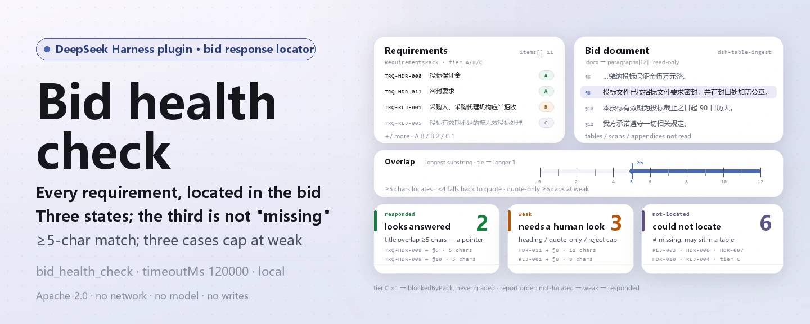
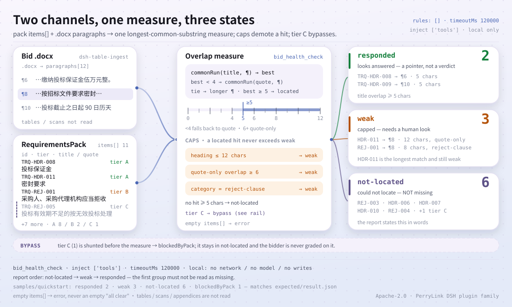

<div align="center">

<picture>
  <source media="(prefers-color-scheme: dark)" srcset="docs/assets/dsh-bid-health-check-hero-en-dark.webp">
  
</picture>

# dsh-bid-health-check

**Contrasta una oferta con su lista de requisitos, uno por uno: qué parece respondido, qué es débil y qué no se pudo localizar.**

Un verificador puramente local para redactores de ofertas: lee un `RequirementsPack` y un `.docx`, informa tres estados a nivel de texto y no emite juicios de cumplimiento, responsabilidad ni sustituye la revisión humana.

[Instalación](#instalación-en-tres-pasos) · [Configuración](#configuración) · [FAQ](#faq) · [简体中文](README.md) · [English](README.en.md) · [Español](README.es.md) · [Português](README.pt.md) · [हिन्दी](README.hi.md)

[](LICENSE)
[](#compatibilidad)
[](https://www.npmjs.com/package/dsh-bid-health-check)
[](https://github.com/PerryLink/dsh-bid-health-check/actions/workflows/ci.yml)
[](#compatibilidad)

[](https://github.com/PerryLink/dsh-bid-health-check/stargazers)
[](https://www.npmjs.com/package/dsh-bid-health-check)
[](https://dshfind.com/plugins/PerryLink/dsh-bid-health-check?ref=badge)
[](https://securityscorecards.dev/viewer/?uri=github.com/PerryLink/dsh-bid-health-check)

```sh
dsh plugin --profile <name> add dsh-bid-health-check
```

</div>

<sub>Plugin comunitario, no afiliado a DeepSeek. Repositorio canónico: <https://github.com/PerryLink/dsh-bid-health-check>.</sub>

## Qué es

`dsh-bid-health-check` lee un `RequirementsPack` (generado por `dsh-tender-requirements`) y un documento de oferta `.docx`, e informa requisito por requisito dónde la oferta parece responder, dónde la coincidencia es débil y dónde no se localizó nada.

La forma honesta de esa pregunta es mucho más estrecha que «¿está completa la oferta?»: la herramienta puede localizar un párrafo que parece responder o no localizarlo. No puede saber si ese párrafo satisface realmente el requisito, y menos aún concluir que un requisito no localizado está sin responder. El informe mantiene «no localizado» en su propio grupo y enuncia esa distinción primero: tratar «no localizado» como «falta» es cómo un licitador acaba reescribiendo una sección que ya estaba, en una tabla, un anexo o con otras palabras.

Hay exactamente dos entradas: la lista de requisitos `pack` (JSON, o YAML con un array `items`) y la oferta `file` (`.docx`). Los párrafos los lee `dsh-table-ingest`; esta versión no lee las tablas dentro de la oferta.

<picture>
  <source media="(prefers-color-scheme: dark)" srcset="docs/assets/dsh-bid-health-check-flow-v5-dark.svg">
  
</picture>

## Instalación en tres pasos

1. **Instalar** (elige un canal):

   ```sh
   # canal git (main más reciente; el script prepare construye lib/)
   dsh plugin --profile web add github:PerryLink/dsh-bid-health-check
   # canal npm (versión publicada, incluye lib/)
   dsh plugin --profile web add dsh-bid-health-check
   # canal tarball: tras pnpm run build && pnpm pack en este repositorio
   dsh plugin --profile web add ./dsh-bid-health-check-<version>.tgz
   ```

2. **Configuración mínima** (los valores por defecto bastan; ajusta el tiempo límite solo si hace falta):

   ```yaml
   - insert:
       - id: dsh-bid-health-check
         name: dsh-bid-health-check
         config:
           timeoutMs: 120000
   ```

   El paquete de reglas se resuelve desde el propio paquete en `rules/bid-health-check.yaml`; no es una clave de configuración. `timeoutMs` es hoy el único ajuste de ejecución.

3. **Comprobar que se monta**:

   ```sh
   dsh --profile web --dump-config | grep 'dsh-bid-health-check'
   node samples/quickstart/run.mjs --check
   ```

   ```text
   bid_health_check: quickstart OK — output matches expected/result.json
   ```

   Resultado esperado de [`samples/quickstart/expected/result.json`](samples/quickstart/expected/result.json): 2 `responded`, 3 `weak`, 6 `not-located`, más 1 bloqueado por el pliego. Captura de la primera ejecución: [`docs/assets/quickstart.png`](docs/assets/quickstart.png); registro: [`docs/assets/quickstart.log`](docs/assets/quickstart.log).

**Desinstalar**: `dsh plugin --profile web remove dsh-bid-health-check` (o elimina la fila del patch del perfil).

## Capacidades principales

`dsh-bid-health-check` hace **localización a nivel de texto entre la lista de requisitos y la oferta**, y asigna a cada requisito uno de tres estados:

- **Tres estados, y el tercero no es «falta»** — `responded` / `weak` / `not-located`. `not-located` solo significa que la herramienta no lo encontró; el informe dice con todas las letras que la oferta puede responder en una tabla, un anexo o con otras palabras.
- **Umbral de cinco caracteres** — el título debe compartir una subcadena común de al menos cinco caracteres con un párrafo de la oferta. Cuatro es demasiado laxo (「投标截止时间」 coincidía por 「投标」).
- **Las coincidencias solo en la cita se degradan** — si el título coincide en menos de cuatro caracteres, se recurre a la cita del requisito; una coincidencia solo de cita de seis caracteres o más se limita a `weak`, porque compartir texto con la cláusula que contiene el requisito no prueba que se cumpla.
- **Los empates van al párrafo más largo** — un encabezado como 「第三章 投标保证金」 repite la etiqueta, mientras que el cuerpo dice el importe.
- **Un encabezado no es una respuesta** — una coincidencia que solo es un título corto (como máximo 12 caracteres y sin puntuación de frase) baja a `weak`.
- **Las cláusulas de rechazo se limitan a `weak`** — son una condición que el licitador debe cumplir, no una frase que responder; ninguna oferta dice 「我方同意被拒收」, así que nunca se puntúan como `responded`.
- **La cola C pasa tal cual** — un requisito que el lado del pliego no pudo extraer de forma fiable se informa como bloqueado por el `RequirementsPack` (`blockedByPack`), no se evalúa contra el licitador.
- **Un paquete vacío se rechaza** — `items: []` lanza un error; una lista vacía haría que toda oferta pareciera no responder nada.
- **Puramente local** — sin red, sin llamadas a modelos, sin escrituras; solo lee las rutas `pack` y `file` que recibe.

### Qué responde

- ¿Qué requisitos tienen un párrafo que plausiblemente los responde?
- ¿Qué coincidencias son solo una frase compartida y necesitan una persona?
- ¿Qué requisitos no tienen respuesta localizada y requieren revisión manual?
- ¿Qué requisitos no pueden comprobarse porque el pliego sigue sin resolver?

### Cómo funciona la coincidencia

Para cada requisito, la herramienta mide la subcadena común más larga entre su título y cada párrafo de la oferta; si la coincidencia del título es inferior a cuatro caracteres, recurre a la cita del requisito. Solo cuenta a partir de cinco caracteres y, en caso de empate, gana el párrafo más largo. Las coincidencias solo de cita de seis caracteres o más se limitan a `weak`, las de encabezado bajan a `weak` y la categoría `reject-clause` también se limita a `weak`. El ordinal del párrafo, un extracto y la longitud de la coincidencia van al informe para que el lector juzgue si ese párrafo es evidencia.

## Configuración

Todos los ajustes son campos de `Config` de Schemastery (sobrescribibles desde `cordis.yml`). Hoy hay una sola clave:

| Clave | Valor por defecto | Significado |
|---|---|---|
| `timeoutMs` | `120000` | Presupuesto de tiempo de ejecución de la herramienta en milisegundos; la capa de herramientas de DSH aborta al vencer |

<details>
<summary>Tabla de configuración completa (1 clave)</summary>

| Clave | Valor por defecto | Significado |
|---|---|---|
| `timeoutMs` | `120000` | Presupuesto de tiempo de ejecución de la herramienta en milisegundos; la capa de herramientas de DSH aborta al vencer |

</details>

El paquete de reglas se resuelve siempre desde el paquete en `rules/bid-health-check.yaml` (las herramientas localizan `rules/<pack>.yaml`); no es una clave de configuración. La lista `rules` de este paquete está vacía: es un consumidor, no un verificador; no cita cláusulas como base de un hallazgo ni emite juicios de cumplimiento.

Ejemplo de sobrescritura en el patch del perfil:

```yaml
- insert:
    - id: dsh-bid-health-check
      name: dsh-bid-health-check
      config:
        timeoutMs: 180000
```

## FAQ

<details>
<summary>¿Sube la oferta? ¿Dónde están los datos?</summary>

Puramente local. La herramienta solo lee las rutas `pack` y `file` que recibe; no hace peticiones de red, no llama a ningún modelo, no escribe archivos ni crea índices. `package.json#dsh.demo` también declara `network: false` y `writes: []`. Eso sí: el informe cita hasta 200 caracteres de los párrafos coincidentes, así que el propio informe debe tratarse con la sensibilidad de la oferta.

</details>

<details>
<summary>¿«No localizado» significa que no se respondió?</summary>

No. El requisito puede estar respondido en una tabla, un anexo, una página escaneada o con otras palabras; esta herramienta solo lee párrafos de `.docx`, así que «no localizado» significa únicamente que esta ejecución no lo encontró. El informe lo dice antes de los resultados y agrupa estos requisitos aparte para revisión manual.

</details>

<details>
<summary>¿«Respondido» significa que se cumple el requisito?</summary>

No. La herramienta devuelve un párrafo que parece responder, con su posición y la longitud de la coincidencia; si realmente satisface el requisito lo decide una persona leyéndolo. Las cláusulas de rechazo son aún más estrictas: son condiciones que cumplir, no frases que responder, así que se limitan a `weak`.

</details>

<details>
<summary>¿Compite con otros plugins por nombres de herramienta, eventos o servicios?</summary>

No. Registra una única herramienta, `bid_health_check`, y declara `inject: ['tools']`; no ofrece service key, no registra comandos, ni slots de cliente, ni prefijos `webServer`, no escucha eventos compartidos y no muta globales. El patch del bundle solo `insert`a su propia fila. La argumentación punto por punto está en «Interoperabilidad con otros plugins de DSH».

</details>

<details>
<summary>¿Cuánto cuesta en rendimiento? ¿Hay benchmark?</summary>

Comparación pura de cadenas —sin red ni llamadas a modelos— con un coste proporcional a requisitos × párrafos × longitud del párrafo (subcadena común más larga). Este repositorio no publica benchmark, así que aquí no se afirman cifras de precisión o recall; los 11 requisitos de `samples/quickstart` se pueden volver a ejecutar y `timeoutMs` acota la ejecución.

</details>

<details>
<summary>Se instala pero la herramienta no aparece, o el resultado está vacío. ¿Qué hago?</summary>

Comprueba primero que `main` apunte a `lib/index.mjs` y que `pnpm run build` lo haya generado; `dsh --profile <name> --dump-config | grep 'dsh-bid-health-check'` debe mostrar la fila; fuera del rango de peers, concede una exención explícita. Si no se ejecutó nada o el resultado está vacío, lee `warnings` y `blockedByPack` del informe; un `items` vacío se rechaza en lugar de presentarse como «todo correcto».

</details>

## Límites de seguridad

- **Sin juicio de cumplimiento.** El informe solo lista diferencias y resultados de localización que puede señalar dentro del material; no emite veredictos de cumplimiento, legales, de responsabilidad ni de rechazo.
- **No localizado ≠ no escrito.** Es el límite más importante: informa de «no encontrado esta vez» y no infiere «falta».
- **Respondido ≠ cumplido.** El párrafo coincidente es una pista para una persona; si satisface el requisito es un juicio humano.
- **Solo lee dos archivos locales.** Sin red, sin llamadas a modelos, sin escrituras; el llamador da ambas rutas y la herramienta no escanea directorios.
- **El informe contiene extractos.** Hasta 200 caracteres de un párrafo coincidente entran en el informe; trátalo con la misma sensibilidad que la oferta.
- **Falla en voz alta.** Un `items` vacío, JSON inválido, un `id` ausente o la falta de `pack`/`file` lanzan un error en lugar de devolver un resultado vacío que pudiera leerse como «todo correcto».

## Limitaciones conocidas

- **Solo párrafos.** Los párrafos vienen de `dsh-table-ingest`; esta versión no lee tablas, páginas escaneadas ni anexos de la oferta, así que las respuestas allí no cuentan.
- **Coincidencia de texto, sin comprender paráfrasis.** Una respuesta con otras palabras se informa como `not-located`; a la inversa, una frase compartida puede dar un falso positivo, por eso `weak` necesita revisión humana.
- **El umbral de cinco caracteres es empírico.** Un requisito cuyo título tenga menos de cinco caracteres puede no coincidir nunca; los títulos largos son más estables pero también requieren confirmación.
- **El borde de cinco caracteres solo de cita.** En la implementación actual, una coincidencia solo de cita de exactamente cinco caracteres aún puede puntuarse como `responded` (`src/model.ts:249`); trata esos elementos como pistas y revísalos a mano.
- **El párrafo localizado es una pista, no un veredicto.** El informe da el ordinal, un extracto y la longitud de coincidencia; no decide si se cumple el requisito.
- **La cola C no se puede comprobar.** Un requisito sin resolver en el pliego solo se informa como `blockedByPack`, nunca se evalúa contra el licitador.
- **Solo `.docx`.** `file` debe ser un `.docx`; PDF y escaneos quedan fuera de esta versión.
- **Un paquete vacío se rechaza.** Falta de `items` o `items: []` lanzan un error.
- **Sin benchmark público.** No se afirman cifras de precisión/recall; la muestra solo verifica el flujo y los recuentos de tres estados.

## Interoperabilidad con otros plugins de DSH

Este plugin hace una sola cosa: registrar la herramienta `bid_health_check`. `src/index.ts` declara `inject: ['tools']` y `apply()` solo llama a `ctx.tools.register(...)` y devuelve la función de baja.

- **Sin colisión de nombres de herramienta.** Un único id, `bid_health_check`; no ocupa otros nombres desnudos.
- **Sin colisión de service key.** No ofrece ninguna service key.
- **Sin colisión de comandos.** No registra comandos `/`.
- **Sin colisión de slots ni HTTP.** No registra slots de cliente ni prefijos `webServer`.
- **Sin listeners de eventos.** No se suscribe a eventos compartidos `agent/*` o `tools/*`, así que no hay cuestión de orden de listeners.
- **Sin mutación global.** No parchea prototipos, no reescribe `process.env` ni sustituye el fetch global.
- **La capa patch solo inserta.** `cordis.patch.yml` inserta su propia fila y nunca sobrescribe el `config` de una fila integrada.

Evidencia estática: `src/index.ts:12` (`inject`), `src/index.ts:24-88` (la única superficie de registro), `cordis.patch.yml:6-8` (la única fila de patch).

## Compatibilidad

| Superficie | Estado |
|---|---|
| Harness | `package.json#engines.dsh`: `>=0.2.1-0 <0.3.0`; peer de `@deepseek-ai/dsh-tools`: `>=0.1.2-rc.1 <0.2.0 \|\| >=0.2.0-0 <0.3.0` |
| Node | `^22.19.0 \|\| >=24.0.0` |
| Plataformas | Donde corra DSH (ESM puro; sin código nativo, sin red, sin llamadas a modelos) |
| Modelo | Cualquier modelo de texto; la herramienta solo compara cadenas locales y no necesita capacidades extra |

## Ecosistema y calidad

- [Paquete npm](https://www.npmjs.com/package/dsh-bid-health-check) (actualmente `0.1.3`)
- [Página en dshfind](https://dshfind.com/plugins/PerryLink/dsh-bid-health-check) (instalaciones y ranking)
- [Informe OpenSSF Scorecard](https://securityscorecards.dev/viewer/?uri=github.com/PerryLink/dsh-bid-health-check) (impulsado por [.github/workflows/scorecard.yml](.github/workflows/scorecard.yml))
- [Repositorio GitHub](https://github.com/PerryLink/dsh-bid-health-check) (canónico)
- [Base de conocimiento del ecosistema](https://perrylink.github.io/dsh-plugin-guide/): guía de desarrollo · datos de selección · criterios de mantenimiento

## Desarrollo

```sh
pnpm install
pnpm run typecheck
pnpm test
pnpm run build
pnpm run verify:self-contained
pnpm run check:lockfile
pnpm run check:readmes
pnpm run check:citations
node samples/quickstart/run.mjs --check
pnpm pack
```

La salida de construcción es `lib/` (`tsdown`); `prepublishOnly` vuelve a ejecutar typecheck, tests, build, la puerta de autocontención, la del lockfile y la de README. El kit compartido se sincroniza con `node ../scripts/sync-shared.mjs dsh-bid-health-check`.

Las imágenes del README las genera [`scripts/gen-readme-assets.py`](scripts/gen-readme-assets.py): la portada (mapas de bits Pillow, zh/en x claro/oscuro) y la figura de estructura (SVG escrito a mano, claro/oscuro), todo reproducible.

| Ruta | Función |
|---|---|
| `src/index.ts` | Entrada del plugin: registra la herramienta `bid_health_check` y lee ambas entradas |
| `src/config.ts` | `Config` de Schemastery: `timeoutMs` |
| `src/model.ts` | Núcleo puro: `readPack`, `commonRun`, `check` |
| `src/report.ts` | Renderizado del resultado en Markdown y JSON |
| `src/shared/` | Kit compartido (carga de reglas, forma del informe, subconjunto YAML, utilidades de tabla); copiado para que el paquete sea autocontenido |
| `rules/bid-health-check.yaml` | Marcador del paquete de reglas (`rules: []`); este paquete es consumidor y no ejecuta comprobaciones |
| `tests/` | vitest; tres estados, cola C, cláusulas de rechazo y el flujo de la muestra |
| `samples/quickstart/` | La ejecución de un minuto: `pack.json`, `.docx` y el resultado esperado |
| `scripts/` | Puertas mecánicas (autocontención, lockfile, sincronía de README, citas) y el generador de imágenes |
| `cordis.patch.yml` | Capa bundle: solo `insert`a su propia fila |

Topics: `dsh`, `dsh-plugin`, `deepseek-harness`, `deepseek`, `cordis`, `bid`, `tender`, `health`, `response`

## Familia y agradecimientos

Este proyecto forma parte de la familia de plugins de DeepSeek Harness de [PerryLink](https://github.com/PerryLink) (todos Apache-2.0). Si te resulta útil, **una estrella ayuda a que la siguiente persona lo encuentre**; no desbloquea nada.

- [@PerryLink](https://github.com/PerryLink) — creador y mantenedor: el localizador por ítem de `RequirementsPack`, el informe de tres estados, el paso de la cola C, el límite de las cláusulas de rechazo y la documentación en cinco idiomas.

<details>
<summary>Desplegar todos los plugins</summary>

| Plugin | Estado |
|---|---|
| **[dsh-aqua-input-check](https://github.com/PerryLink/dsh-aqua-input-check)** |  |
| **[dsh-archive-check](https://github.com/PerryLink/dsh-archive-check)** |  |
| **[dsh-auto-review](https://github.com/PerryLink/dsh-auto-review)** |  |
| **[dsh-autotier](https://github.com/PerryLink/dsh-autotier)** | 🧊 CONGELADO — ver el README del repo |
| **[dsh-bid-ca-precheck](https://github.com/PerryLink/dsh-bid-ca-precheck)** |  |
| **[dsh-bid-qual-check](https://github.com/PerryLink/dsh-bid-qual-check)** |  |
| **[dsh-cert-mcp](https://github.com/PerryLink/dsh-cert-mcp)** | 🧊 CONGELADO — ver el README del repo |
| **[dsh-checkpoint-rewind](https://github.com/PerryLink/dsh-checkpoint-rewind)** |  |
| **[dsh-click](https://github.com/PerryLink/dsh-click)** |  |
| **[dsh-composer-history](https://github.com/PerryLink/dsh-composer-history)** |  |
| **[dsh-contract-stance](https://github.com/PerryLink/dsh-contract-stance)** |  |
| **[dsh-customs-doc-check](https://github.com/PerryLink/dsh-customs-doc-check)** |  |
| **[dsh-data-quality](https://github.com/PerryLink/dsh-data-quality)** |  |
| **[dsh-demurrage-ledger](https://github.com/PerryLink/dsh-demurrage-ledger)** |  |
| **[dsh-doublecheck](https://github.com/PerryLink/dsh-doublecheck)** |  |
| **[dsh-drill-script-check](https://github.com/PerryLink/dsh-drill-script-check)** |  |
| **[dsh-eia-guide-check](https://github.com/PerryLink/dsh-eia-guide-check)** |  |
| **[dsh-emergency-plan](https://github.com/PerryLink/dsh-emergency-plan)** |  |
| **[dsh-essay-rubric-check](https://github.com/PerryLink/dsh-essay-rubric-check)** |  |
| **[dsh-evidence-check](https://github.com/PerryLink/dsh-evidence-check)** |  |
| **[dsh-export-ctl-check](https://github.com/PerryLink/dsh-export-ctl-check)** |  |
| **[dsh-fast](https://github.com/PerryLink/dsh-fast)** |  |
| **[dsh-fmea-table-check](https://github.com/PerryLink/dsh-fmea-table-check)** |  |
| **[dsh-forecast-penalty](https://github.com/PerryLink/dsh-forecast-penalty)** |  |
| **[dsh-fund-research](https://github.com/PerryLink/dsh-fund-research)** |  |
| **[dsh-github](https://github.com/PerryLink/dsh-github)** |  |
| **[dsh-gongwen-flow-check](https://github.com/PerryLink/dsh-gongwen-flow-check)** |  |
| **[dsh-gongwen-word-check](https://github.com/PerryLink/dsh-gongwen-word-check)** |  |
| **[dsh-guard-plan-qc](https://github.com/PerryLink/dsh-guard-plan-qc)** |  |
| **[dsh-hazchem-check](https://github.com/PerryLink/dsh-hazchem-check)** |  |
| **[dsh-hazplan-check](https://github.com/PerryLink/dsh-hazplan-check)** |  |
| **[dsh-hidden-risk-map](https://github.com/PerryLink/dsh-hidden-risk-map)** |  |
| **[dsh-hs-classify](https://github.com/PerryLink/dsh-hs-classify)** |  |
| **[dsh-icd-rule-check](https://github.com/PerryLink/dsh-icd-rule-check)** |  |
| **[dsh-industry-research](https://github.com/PerryLink/dsh-industry-research)** |  |
| **[dsh-lawcite-adapter](https://github.com/PerryLink/dsh-lawcite-adapter)** |  |
| **[dsh-laya](https://github.com/PerryLink/dsh-laya)** |  |
| **[dsh-lc-doc-check](https://github.com/PerryLink/dsh-lc-doc-check)** |  |
| **[dsh-learning-gap-check](https://github.com/PerryLink/dsh-learning-gap-check)** |  |
| **[dsh-library](https://github.com/PerryLink/dsh-library)** |  |
| **[dsh-local-ai](https://github.com/PerryLink/dsh-local-ai)** |  |
| **[dsh-lsp-actions](https://github.com/PerryLink/dsh-lsp-actions)** |  |
| **[dsh-mask](https://github.com/PerryLink/dsh-mask)** |  |
| **[dsh-mcp-panel](https://github.com/PerryLink/dsh-mcp-panel)** |  |
| **[dsh-medrec-qc](https://github.com/PerryLink/dsh-medrec-qc)** |  |
| **[dsh-memento](https://github.com/PerryLink/dsh-memento)** |  |
| **[dsh-nsfc-form-check](https://github.com/PerryLink/dsh-nsfc-form-check)** |  |
| **[dsh-nurse-record-check](https://github.com/PerryLink/dsh-nurse-record-check)** |  |
| **[dsh-observe](https://github.com/PerryLink/dsh-observe)** |  |
| **[dsh-origin-rvc-check](https://github.com/PerryLink/dsh-origin-rvc-check)** |  |
| **[dsh-ota-review-check](https://github.com/PerryLink/dsh-ota-review-check)** |  |
| **[dsh-output-styles](https://github.com/PerryLink/dsh-output-styles)** |  |
| **[dsh-paper-doc-adapter](https://github.com/PerryLink/dsh-paper-doc-adapter)** |  |
| **[dsh-permission-rules](https://github.com/PerryLink/dsh-permission-rules)** |  |
| **[dsh-permit-report-check](https://github.com/PerryLink/dsh-permit-report-check)** |  |
| **[dsh-pipeline-check](https://github.com/PerryLink/dsh-pipeline-check)** |  |
| **[dsh-pleading-draft](https://github.com/PerryLink/dsh-pleading-draft)** |  |
| **[dsh-plugin-doctor](https://github.com/PerryLink/dsh-plugin-doctor)** | 🚫 RETIRADO (repo archivado) |
| **[dsh-plugin-guide](https://github.com/PerryLink/dsh-plugin-guide)** |  |
| **[dsh-plugin-kit](https://github.com/PerryLink/dsh-plugin-kit)** | 🚫 RETIRADO (repo archivado) |
| **[dsh-plugin-upgrade](https://github.com/PerryLink/dsh-plugin-upgrade)** | 🚫 RETIRADO (repo archivado) |
| **[dsh-policy-brief-draft](https://github.com/PerryLink/dsh-policy-brief-draft)** |  |
| **[dsh-power-loss-split](https://github.com/PerryLink/dsh-power-loss-split)** |  |
| **[dsh-power-ticket-check](https://github.com/PerryLink/dsh-power-ticket-check)** |  |
| **[dsh-ppap-check](https://github.com/PerryLink/dsh-ppap-check)** |  |
| **[dsh-protest-deadline](https://github.com/PerryLink/dsh-protest-deadline)** |  |
| **[dsh-railway-window](https://github.com/PerryLink/dsh-railway-window)** |  |
| **[dsh-repair-order-qc](https://github.com/PerryLink/dsh-repair-order-qc)** |  |
| **[dsh-research-report](https://github.com/PerryLink/dsh-research-report)** |  |
| **[dsh-review-reply-check](https://github.com/PerryLink/dsh-review-reply-check)** |  |
| **[dsh-rulefile-check](https://github.com/PerryLink/dsh-rulefile-check)** |  |
| **[dsh-safety-brief-check](https://github.com/PerryLink/dsh-safety-brief-check)** |  |
| **[dsh-score](https://github.com/PerryLink/dsh-score)** |  |
| **[dsh-session-sync](https://github.com/PerryLink/dsh-session-sync)** |  |
| **[dsh-site-log-check](https://github.com/PerryLink/dsh-site-log-check)** |  |
| **[dsh-skill-pack-security](https://github.com/PerryLink/dsh-skill-pack-security)** |  |
| **[dsh-soe-decision-check](https://github.com/PerryLink/dsh-soe-decision-check)** |  |
| **[dsh-soilwater-check](https://github.com/PerryLink/dsh-soilwater-check)** |  |
| **[dsh-sop-sync-check](https://github.com/PerryLink/dsh-sop-sync-check)** |  |
| **[dsh-spc-gbt-adapter](https://github.com/PerryLink/dsh-spc-gbt-adapter)** |  |
| **[dsh-talk](https://github.com/PerryLink/dsh-talk)** |  |
| **[dsh-tender-extract](https://github.com/PerryLink/dsh-tender-extract)** |  |
| **[dsh-tender-matrix](https://github.com/PerryLink/dsh-tender-matrix)** |  |
| **[dsh-test-drive](https://github.com/PerryLink/dsh-test-drive)** |  |
| **[dsh-ticktick](https://github.com/PerryLink/dsh-ticktick)** | 🚫 RETIRADO (repo archivado) |
| **[dsh-translate](https://github.com/PerryLink/dsh-translate)** |  |
| **[dsh-warranty-calc](https://github.com/PerryLink/dsh-warranty-calc)** |  |
| **[dsh-budget](https://github.com/PerryLink/dsh-budget)** | 🧊 CONGELADO — ver el README del repo |
| **[dsh-claude-move](https://github.com/PerryLink/dsh-claude-move)** | 🧊 CONGELADO — ver el README del repo |
| **[dsh-defend](https://github.com/PerryLink/dsh-defend)** | 🧊 CONGELADO — ver el README del repo |
| **[dsh-draw](https://github.com/PerryLink/dsh-draw)** | 🧊 CONGELADO — ver el README del repo |
| **[dsh-reach](https://github.com/PerryLink/dsh-reach)** | 🧊 CONGELADO — ver el README del repo |
| **[dsh-background-agents](https://github.com/PerryLink/dsh-background-agents)** | 🚫 RETIRADO (repo archivado) |
| **[dsh-session-pin](https://github.com/PerryLink/dsh-session-pin)** | 🚫 RETIRADO (repo archivado) |
| **[dsh-team-rooms](https://github.com/PerryLink/dsh-team-rooms)** | 🚫 RETIRADO (repo archivado) |

</details>

## Licencia

[LICENSE](LICENSE) (Apache License 2.0) © 2026 dsh-bid-health-check contributors

<p align="center"><sub>Apache-2.0 · Plugin comunitario, no afiliado a DeepSeek.</sub></p>
