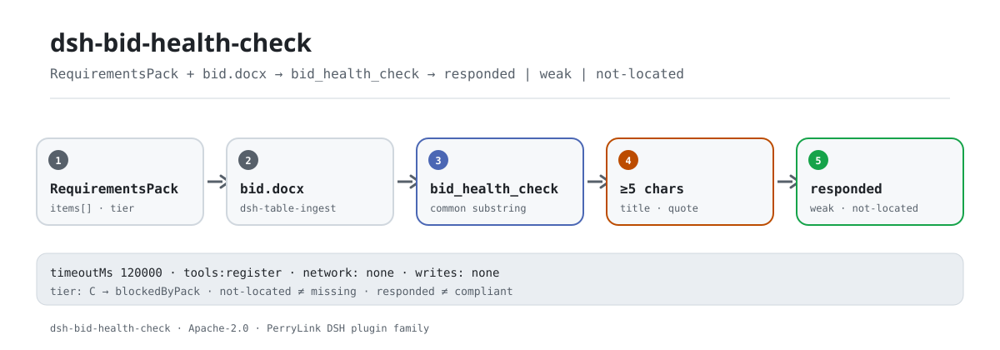

<div align="center">

<picture>
  <source media="(prefers-color-scheme: dark)" srcset="docs/assets/dsh-bid-health-check-flow-dark.svg">
  
</picture>

# dsh-bid-health-check

**बोली को आवश्यकता सूची से एक-एक करके मिलाएँ — कहाँ उत्तर दिखता है, कहाँ कमज़ोर है, और कहाँ कुछ नहीं मिला, एक ही पास में।**

बोली लिखने वालों के लिए पूरी तरह स्थानीय जाँच उपकरण: एक `RequirementsPack` और एक `.docx` पढ़ता है, शब्द-स्तर पर तीन स्थितियाँ बताता है, और अनुपालन, दायित्व या मानवीय समीक्षा का विकल्प होने का दावा नहीं करता।

[इंस्टॉल](#तीन-चरणों-में-शुरुआत) · [कॉन्फ़िगरेशन](#कॉन्फ़िगरेशन) · [FAQ](#faq) · [简体中文](README.md) · [English](README.en.md) · [Español](README.es.md) · [Português](README.pt.md) · [हिन्दी](README.hi.md)

[](LICENSE)
[](#अनुकूलता)
[](https://www.npmjs.com/package/dsh-bid-health-check)
[](https://github.com/PerryLink/dsh-bid-health-check/actions/workflows/ci.yml)
[](#अनुकूलता)

[](https://github.com/PerryLink/dsh-bid-health-check/stargazers)
[](https://www.npmjs.com/package/dsh-bid-health-check)
[](https://dshfind.com/plugins/PerryLink/dsh-bid-health-check?ref=badge)
[](https://securityscorecards.dev/viewer/?uri=github.com/PerryLink/dsh-bid-health-check)

```sh
dsh plugin --profile <name> add dsh-bid-health-check
```

</div>

<sub>समुदाय प्लगइन, DeepSeek से संबद्ध नहीं। आधिकारिक रेपो: <https://github.com/PerryLink/dsh-bid-health-check>।</sub>

## यह क्या है

`dsh-bid-health-check` एक `RequirementsPack` (जो `dsh-tender-requirements` बनाता है) और एक बोली दस्तावेज़ `.docx` पढ़कर आवश्यकता दर आवश्यकता बताता है कि कहाँ बोली उत्तर देती दिखती है, कहाँ मेल कमज़ोर है, और कहाँ कुछ भी नहीं मिला।

इस प्रश्न का ईमानदार रूप «क्या बोली पूरी है» से बहुत संकरा है: उपकरण कोई अनुच्छेद ढूँढ सकता है या नहीं ढूँढ सकता। वह नहीं जान सकता कि मिला हुआ अनुच्छेद आवश्यकता वास्तव में पूरी करता है या नहीं, और यह भी नहीं कह सकता कि न मिली आवश्यकता का उत्तर नहीं दिया गया। रिपोर्ट «नहीं मिला» को अलग समूह में रखती है और यह अंतर सबसे पहले लिखती है — «नहीं मिला» को «अनुपस्थित» मान लेना ही वह कारण है जिससे कोई लेखक ऐसा अनुभाग दोबारा लिख देता है जो पहले से तालिका, परिशिष्ट या दूसरे शब्दों में मौजूद था।

इनपुट ठीक दो हैं: आवश्यकता सूची `pack` (JSON, या `items` array वाला YAML) और बोली `file` (`.docx`)। अनुच्छेद `dsh-table-ingest` पढ़ता है; यह संस्करण बोली के अंदर की तालिकाएँ नहीं पढ़ता।

## तीन चरणों में शुरुआत

1. **इंस्टॉल** (कोई एक चैनल चुनें):

   ```sh
   # git चैनल (नवीनतम main; prepare स्क्रिप्ट lib/ बनाती है)
   dsh plugin --profile web add github:PerryLink/dsh-bid-health-check
   # npm चैनल (प्रकाशित संस्करण, lib/ सहित)
   dsh plugin --profile web add dsh-bid-health-check
   # tarball चैनल: इस रेपो में pnpm run build && pnpm pack के बाद
   dsh plugin --profile web add ./dsh-bid-health-check-<version>.tgz
   ```

2. **न्यूनतम कॉन्फ़िगरेशन** (डिफ़ॉल्ट काफ़ी हैं; ज़रूरत हो तो केवल टाइमआउट बदलें):

   ```yaml
   - insert:
       - id: dsh-bid-health-check
         name: dsh-bid-health-check
         config:
           timeoutMs: 120000
   ```

   नियम पैक पैकेज के अंदर `rules/bid-health-check.yaml` से हल होता है; यह कॉन्फ़िगरेशन कुंजी नहीं है। `timeoutMs` आज एकमात्र रनटाइम सेटिंग है।

3. **जाँचें कि माउंट हुआ**:

   ```sh
   dsh --profile web --dump-config | grep 'dsh-bid-health-check'
   node samples/quickstart/run.mjs --check
   ```

   ```text
   bid_health_check: quickstart OK — output matches expected/result.json
   ```

   [`samples/quickstart/expected/result.json`](samples/quickstart/expected/result.json) से अपेक्षित परिणाम: 2 `responded`, 3 `weak`, 6 `not-located`, और 1 टेंडर पक्ष से अवरुद्ध। पहली बार चलाने का स्क्रीनशॉट: [`docs/assets/quickstart.png`](docs/assets/quickstart.png); रन लॉग: [`docs/assets/quickstart.log`](docs/assets/quickstart.log)।

**अनइंस्टॉल**: `dsh plugin --profile web remove dsh-bid-health-check` (या प्रोफ़ाइल पैच से वह पंक्ति हटा दें)।

## मुख्य क्षमताएँ

`dsh-bid-health-check` **आवश्यकता सूची और बोली के बीच शब्द-स्तरीय स्थान-निर्धारण** करता है, और हर आवश्यकता को तीन में से एक स्थिति में रखता है:

- **तीन स्थितियाँ, और तीसरी «अनुपस्थित» नहीं है** — `responded` / `weak` / `not-located`। `not-located` का अर्थ केवल यह है कि उपकरण को नहीं मिला; रिपोर्ट स्पष्ट कहती है कि उत्तर तालिका, परिशिष्ट या दूसरे शब्दों में हो सकता है।
- **पाँच अक्षरों की सीमा** — शीर्षक और बोली के अनुच्छेद के बीच सबसे लंबी साझा उप-शृंखला कम से कम पाँच अक्षर होनी चाहिए। चार बहुत ढीले हैं (「投标截止时间」 「投标」 पर मिल जाता था)।
- **केवल उद्धरण में मेल पर अवनति** — शीर्षक का मेल चार अक्षरों से कम हो तो आवश्यकता के उद्धरण (quote) पर लौटा जाता है; केवल उद्धरण वाला छह अक्षर या अधिक का मेल `weak` तक सीमित रहता है, क्योंकि जिस धारा में आवश्यकता है उससे पाठ साझा करना उसके पूरा होने का प्रमाण नहीं है।
- **बराबरी में लंबा अनुच्छेद जीतता है** — 「第三章 投标保证金」 जैसा शीर्षक लेबल दोहराता है, जबकि राशि मुख्य पाठ में होती है।
- **शीर्षक उत्तर नहीं है** — यदि मेल केवल एक छोटा शीर्षक है (अधिकतम 12 अक्षर और वाक्य-विराम नहीं), तो वह `weak` हो जाता है।
- **अस्वीकृति धाराएँ `weak` तक** — वे ऐसी शर्त हैं जो बोली लगाने वाले को पूरी करनी है, उत्तर देने योग्य वाक्य नहीं; कोई बोली 「我方同意被拒收」 नहीं लिखती, इसलिए ऐसी धारा कभी `responded` नहीं गिनी जाती।
- **C कतार आगे बढ़ती है** — जिस आवश्यकता को टेंडर पक्ष भरोसे से नहीं निकाल सका, उसे `RequirementsPack` (`blockedByPack`) से अवरुद्ध बताया जाता है, बोली लगाने वाले पर नहीं परखा जाता।
- **खाली पैक अस्वीकृत** — `items: []` पर सीधे त्रुटि; खाली सूची से हर बोली «कुछ नहीं का उत्तर» जैसी लगती।
- **पूरी तरह स्थानीय** — कोई नेटवर्क नहीं, कोई मॉडल कॉल नहीं, कोई फ़ाइल लेखन नहीं; केवल दिए गए `pack` और `file` पथ पढ़ता है।

### यह किन सवालों का जवाब देता है

- किन आवश्यकताओं के लिए संभावित उत्तर देने वाला अनुच्छेद मिला?
- कौन-से मेल केवल साझा वाक्यांश हैं और किसी व्यक्ति को देखने की ज़रूरत है?
- किन आवश्यकताओं का कोई उत्तर नहीं मिला, जिन्हें हाथ से जाँचना है?
- कौन-सी आवश्यकताएँ इसलिए जाँची नहीं जा सकीं क्योंकि टेंडर पक्ष अभी अनसुलझा है?

### मिलान कैसे होता है

हर आवश्यकता के लिए उपकरण उसके शीर्षक और बोली के हर अनुच्छेद के बीच सबसे लंबी साझा उप-शृंखला नापता है; शीर्षक का मेल चार अक्षरों से कम हो तो आवश्यकता के उद्धरण पर लौटा जाता है। मेल पाँच अक्षर या अधिक पर ही गिना जाता है, और बराबरी में लंबा अनुच्छेद जीतता है। केवल उद्धरण वाले छह अक्षर या अधिक के मेल `weak` तक, शीर्षक-मेल `weak`, और `reject-clause` श्रेणी भी `weak` तक सीमित है। मिले अनुच्छेद का क्रमांक, अंश और मेल की लंबाई रिपोर्ट में जाती है, ताकि पाठक तय कर सके कि वह अनुच्छेद प्रमाण है या नहीं।

## कॉन्फ़िगरेशन

सभी समायोज्य Schemastery `Config` फ़ील्ड हैं (`cordis.yml` से बदले जा सकते हैं)। आज एक ही कुंजी है:

| कुंजी | डिफ़ॉल्ट | अर्थ |
|---|---|---|
| `timeoutMs` | `120000` | उपकरण निष्पादन टाइमआउट बजट (मिलीसेकंड); समाप्त होने पर DSH टूल परत निरस्त करती है |

<details>
<summary>पूर्ण कॉन्फ़िगरेशन तालिका (1 कुंजी)</summary>

| कुंजी | डिफ़ॉल्ट | अर्थ |
|---|---|---|
| `timeoutMs` | `120000` | उपकरण निष्पादन टाइमआउट बजट (मिलीसेकंड); समाप्त होने पर DSH टूल परत निरस्त करती है |

</details>

नियम पैक हमेशा पैकेज के अंदर `rules/bid-health-check.yaml` से हल होता है (टूलींग `rules/<pack>.yaml` ढूँढती है); यह कॉन्फ़िगरेशन कुंजी नहीं है। इस पैकेज की `rules` सूची खाली है — यह उपभोक्ता है, जाँचकर्ता नहीं; यह किसी धारा को निष्कर्ष का आधार नहीं बनाता और अनुपालन का निर्णय नहीं देता।

प्रोफ़ाइल पैच में ओवरराइड उदाहरण:

```yaml
- insert:
    - id: dsh-bid-health-check
      name: dsh-bid-health-check
      config:
        timeoutMs: 180000
```

## FAQ

<details>
<summary>क्या यह बोली अपलोड करता है? डेटा कहाँ रहता है?</summary>

पूरी तरह स्थानीय। उपकरण केवल दिए गए `pack` और `file` पथ पढ़ता है; कोई नेटवर्क अनुरोध नहीं, कोई मॉडल कॉल नहीं, कोई फ़ाइल लेखन नहीं, कोई इंडेक्स नहीं। `package.json#dsh.demo` में भी `network: false` और `writes: []` घोषित हैं। ध्यान दें: रिपोर्ट मिले अनुच्छेदों से 200 अक्षर तक उद्धृत करती है, इसलिए रिपोर्ट को बोली जैसी संवेदनशीलता से संभालें।

</details>

<details>
<summary>«नहीं मिला» का अर्थ है उत्तर नहीं दिया गया?</summary>

नहीं। आवश्यकता तालिका, परिशिष्ट, स्कैन किए पृष्ठ या दूसरे शब्दों में उत्तरित हो सकती है; यह उपकरण केवल `.docx` के अनुच्छेद पढ़ता है, इसलिए «नहीं मिला» का अर्थ केवल यह है कि इस बार नहीं मिला। रिपोर्ट परिणामों से पहले यह वाक्य लिखती है और इन आवश्यकताओं को मैन्युअल जाँच के लिए अलग समूह में रखती है।

</details>

<details>
<summary>«उत्तर मिला» का अर्थ है आवश्यकता पूरी हुई?</summary>

नहीं। उपकरण ऐसा अनुच्छेद देता है जो उत्तर देता दिखता है, उसकी स्थिति और मेल की लंबाई के साथ; वह आवश्यकता वास्तव में पूरी करता है या नहीं, यह इंसान पढ़कर तय करता है। अस्वीकृति धाराएँ और भी सख्त हैं: वे पूरी करने की शर्तें हैं, उत्तर देने के वाक्य नहीं, इसलिए `weak` तक सीमित हैं।

</details>

<details>
<summary>क्या यह दूसरे प्लगइन के साथ टूल नाम, इवेंट या सेवा पर टकराता है?</summary>

नहीं। यह केवल एक टूल `bid_health_check` पंजीकृत करता है और `inject: ['tools']` घोषित करता है; कोई service key नहीं, कोई कमांड नहीं, कोई क्लाइंट slot नहीं, कोई `webServer` उपसर्ग नहीं, कोई साझा इवेंट श्रोता नहीं, कोई ग्लोबल बदलाव नहीं। bundle patch केवल अपनी पंक्ति `insert` करता है। विस्तृत तर्क «अन्य DSH प्लगइन के साथ अंतर-संचालन» में है।

</details>

<details>
<summary>प्रदर्शन लागत कितनी है? क्या benchmark है?</summary>

शुद्ध स्ट्रिंग तुलना — कोई नेटवर्क नहीं, कोई मॉडल कॉल नहीं — लागत लगभग आवश्यकताएँ × अनुच्छेद × अनुच्छेद की लंबाई (सबसे लंबी साझा उप-शृंखला)। इस रेपो में कोई सार्वजनिक benchmark नहीं है, इसलिए यहाँ सटीकता/recall के आँकड़े नहीं दिए गए; `samples/quickstart` की 11 आवश्यकताएँ दोबारा चलाई जा सकती हैं, और `timeoutMs` अवधि सीमित करता है।

</details>

<details>
<summary>इंस्टॉल हो गया पर टूल दिखता नहीं, या परिणाम खाली है। क्या करें?</summary>

पहले जाँचें कि `main` `lib/index.mjs` की ओर इशारा करता है और `pnpm run build` ने उसे बनाया है; `dsh --profile <name> --dump-config | grep 'dsh-bid-health-check'` में पंक्ति दिखनी चाहिए; peer सीमा से बाहर हों तो स्पष्ट छूट दें। यदि कोई जाँच नहीं चली या परिणाम खाली है, तो रिपोर्ट के `warnings` और `blockedByPack` पढ़ें; खाली `items` को «सब ठीक» के रूप में प्रस्तुत करने के बजाय सीधे अस्वीकार किया जाता है।

</details>

## सुरक्षा सीमाएँ

- **कोई अनुपालन निर्णय नहीं।** रिपोर्ट केवल वे अंतर और स्थान-परिणाम सूचीबद्ध करती है जिन्हें सामग्री के अंदर इंगित किया जा सके; अनुपालन, कानूनी, दायित्व या अस्वीकृति का फ़ैसला नहीं देती।
- **नहीं मिला ≠ नहीं लिखा।** यह उपकरण की सबसे महत्वपूर्ण सीमा है: यह «इस बार नहीं मिला» बताता है, «अनुपस्थित» का अनुमान नहीं लगाता।
- **उत्तर मिला ≠ पूरा हुआ।** मिला अनुच्छेद इंसान के लिए संकेत है; आवश्यकता पूरी है या नहीं, यह मानवीय निर्णय है।
- **केवल दो स्थानीय फ़ाइलें पढ़ता है।** कोई नेटवर्क नहीं, कोई मॉडल कॉल नहीं, कोई लेखन नहीं; दोनों पथ कॉलर देता है और उपकरण डायरेक्टरी स्कैन नहीं करता।
- **रिपोर्ट में मूल अंश हैं।** मिले अनुच्छेद के 200 अक्षर तक रिपोर्ट में आते हैं; रिपोर्ट को बोली जैसी ही संवेदनशीलता से संभालें।
- **स्पष्ट विफलता।** खाली `items`, अमान्य JSON, अनुपस्थित `id`, या `pack`/`file` तर्क न होने पर त्रुटि होती है — खाली परिणाम «सब ठीक» पढ़े जाने के जोखिम के बजाय।

## ज्ञात सीमाएँ

- **केवल अनुच्छेद।** अनुच्छेद `dsh-table-ingest` से आते हैं; यह संस्करण बोली की तालिकाएँ, स्कैन किए पृष्ठ या परिशिष्ट नहीं पढ़ता, इसलिए वहाँ के उत्तर पूरी तरह नहीं गिने जाते।
- **शब्द-स्तरीय मिलान, पर्यायवाची समझ नहीं।** दूसरे शब्दों में लिखा उत्तर `not-located` बताया जाएगा; उलटा, साझा वाक्यांश झूठा मेल भी दे सकता है, इसलिए `weak` को इंसान देखे।
- **पाँच अक्षरों की सीमा अनुभवजन्य है।** जिस आवश्यकता का शीर्षक ही पाँच अक्षरों से छोटा हो, वह कभी न मिले; लंबे शीर्षक अधिक स्थिर हैं, पर पुष्टि फिर भी चाहिए।
- **केवल उद्धरण की पाँच-अक्षर सीमा।** वर्तमान कार्यान्वयन में केवल उद्धरण वाला ठीक पाँच अक्षर का मेल भी `responded` मिल सकता है (`src/model.ts:249`); ऐसे आइटम को संकेत मानें और हाथ से जाँचें।
- **मिला अनुच्छेद संकेत है, निर्णय नहीं।** रिपोर्ट क्रमांक, अंश और मेल की लंबाई देती है; आवश्यकता पूरी है या नहीं, यह तय नहीं करती।
- **C कतार की जाँच नहीं हो सकती।** टेंडर पक्ष पर अनसुलझी आवश्यकता केवल `blockedByPack` बताई जाती है, बोली लगाने वाले पर कभी नहीं परखी जाती।
- **केवल `.docx`।** `file` `.docx` होना चाहिए; PDF और स्कैन इस संस्करण के दायरे से बाहर हैं।
- **खाली पैक अस्वीकृत।** `items` न होना या `items: []` होना त्रुटि देता है।
- **कोई सार्वजनिक benchmark नहीं।** सटीकता/recall के आँकड़े नहीं; नमूना केवल पाइपलाइन और तीन-स्थिति गणना जाँचता है।

## अन्य DSH प्लगइन के साथ अंतर-संचालन

यह प्लगइन एक ही काम करता है: `bid_health_check` टूल पंजीकृत करना। `src/index.ts` में `inject: ['tools']` है, और `apply()` केवल `ctx.tools.register(...)` कॉल करता है और अनरजिस्टर फ़ंक्शन लौटाता है।

- **टूल नाम का टकराव नहीं।** केवल एक टूल id, `bid_health_check`; कोई अन्य नंगा नाम नहीं लिया जाता।
- **service key का टकराव नहीं।** कोई service key नहीं देता।
- **कमांड का टकराव नहीं।** कोई `/` कमांड पंजीकृत नहीं करता।
- **slot / HTTP टकराव नहीं।** कोई क्लाइंट slot या `webServer` उपसर्ग पंजीकृत नहीं करता।
- **कोई इवेंट श्रोता नहीं।** किसी साझा `agent/*` या `tools/*` इवेंट की सदस्यता नहीं, इसलिए श्रोता-क्रम का प्रश्न नहीं।
- **कोई ग्लोबल बदलाव नहीं।** प्रोटोटाइप नहीं बदलता, `process.env` नहीं लिखता, वैश्विक fetch नहीं बदलता।
- **patch परत केवल insert करती है।** `cordis.patch.yml` अपनी पंक्ति insert करता है और अंतर्निहित पंक्ति का `config` कभी नहीं लिखता।

स्थिर प्रमाण: `src/index.ts:12` (`inject`), `src/index.ts:24-88` (एकमात्र पंजीकरण सतह), `cordis.patch.yml:6-8` (एकमात्र patch पंक्ति)।

## अनुकूलता

| सतह | स्थिति |
|---|---|
| Harness | `package.json#engines.dsh`: `>=0.2.1-0 <0.3.0`; `@deepseek-ai/dsh-tools` peer: `>=0.1.2-rc.1 <0.2.0 \|\| >=0.2.0-0 <0.3.0` |
| Node | `^22.19.0 \|\| >=24.0.0` |
| प्लेटफ़ॉर्म | जहाँ DSH चले (शुद्ध ESM; कोई मूल कोड नहीं, कोई नेटवर्क नहीं, कोई मॉडल कॉल नहीं) |
| मॉडल | कोई भी टेक्स्ट मॉडल; उपकरण केवल स्थानीय स्ट्रिंग तुलना करता है, अतिरिक्त क्षमता नहीं चाहिए |

## इकोसिस्टम और गुणवत्ता

- [npm पैकेज](https://www.npmjs.com/package/dsh-bid-health-check) (वर्तमान `0.1.3`)
- [dshfind प्लगइन पेज](https://dshfind.com/plugins/PerryLink/dsh-bid-health-check) (इंस्टॉल और रैंकिंग)
- [OpenSSF Scorecard रिपोर्ट](https://securityscorecards.dev/viewer/?uri=github.com/PerryLink/dsh-bid-health-check) ([.github/workflows/scorecard.yml](.github/workflows/scorecard.yml) द्वारा संचालित)
- [GitHub रेपो](https://github.com/PerryLink/dsh-bid-health-check) (आधिकारिक)
- [इकोसिस्टम ज्ञान आधार](https://perrylink.github.io/dsh-plugin-guide/): प्लगइन विकास गाइड · चयन डेटा · रखरखाव मानदंड

## विकास

```sh
pnpm install
pnpm run typecheck
pnpm test
pnpm run build
pnpm run verify:self-contained
pnpm run check:lockfile
pnpm run check:readmes
pnpm run check:citations
node samples/quickstart/run.mjs --check
pnpm pack
```

बिल्ड आउटपुट `lib/` (`tsdown`) है; `prepublishOnly` typecheck, टेस्ट, build, स्व-निहित गेट, lockfile और README गेट दोबारा चलाता है। साझा kit `node ../scripts/sync-shared.mjs dsh-bid-health-check` से सिंक होता है।

README की छवियाँ [`scripts/gen-readme-assets.py`](scripts/gen-readme-assets.py) बनाता है: दो वेक्टर SVG (हल्का/गहरा), दोबारा चलाना सुरक्षित है।

| पथ | भूमिका |
|---|---|
| `src/index.ts` | प्लगइन प्रवेश: `bid_health_check` टूल पंजीकृत करता है और दोनों इनपुट पढ़ता है |
| `src/config.ts` | Schemastery `Config`: `timeoutMs` |
| `src/model.ts` | शुद्ध जाँच कोर: `readPack`, `commonRun`, `check` |
| `src/report.ts` | Markdown और JSON परिणाम रेंडरिंग |
| `src/shared/` | साझा kit (नियम लोडर, रिपोर्ट आकार, YAML उपसमुच्चय, तालिका सहायक); पैकेज स्व-निहित रहे इसलिए कॉपी किया गया |
| `rules/bid-health-check.yaml` | नियम पैक प्लेसहोल्डर (`rules: []`); यह पैकेज उपभोक्ता है, जाँच नहीं चलाता |
| `tests/` | vitest; तीन स्थितियाँ, C कतार, अस्वीकृति धाराएँ और नमूना पाइपलाइन |
| `samples/quickstart/` | एक मिनट की शुरुआत: `pack.json`, `.docx` और अपेक्षित परिणाम |
| `scripts/` | यांत्रिक गेट (स्व-निहित, lockfile, README सिंक, उद्धरण) और छवि जनरेटर |
| `cordis.patch.yml` | bundle परत: केवल अपनी पंक्ति `insert` |

Topics: `dsh`, `dsh-plugin`, `deepseek-harness`, `deepseek`, `cordis`, `bid`, `tender`, `health`, `response`

## परिवार और आभार

यह परियोजना [PerryLink](https://github.com/PerryLink) के DeepSeek Harness प्लगइन परिवार का हिस्सा है (सभी Apache-2.0)। अगर यह उपयोगी हो, **एक star अगले व्यक्ति को इसे खोजने में मदद करता है** — इससे कोई सुविधा अनलॉक नहीं होती।

- [@PerryLink](https://github.com/PerryLink) — निर्माता और अनुरक्षक: `RequirementsPack` का प्रति-आइटम लोकेटर, तीन-स्थिति रिपोर्ट, C कतार पास-थ्रू, अस्वीकृति धारा सीमा और पाँच-भाषा दस्तावेज़।

<details>
<summary>सभी प्लगइन विस्तारित करें</summary>

| प्लगइन | स्थिति |
|---|---|
| **[dsh-aqua-input-check](https://github.com/PerryLink/dsh-aqua-input-check)** |  |
| **[dsh-archive-check](https://github.com/PerryLink/dsh-archive-check)** |  |
| **[dsh-auto-review](https://github.com/PerryLink/dsh-auto-review)** |  |
| **[dsh-autotier](https://github.com/PerryLink/dsh-autotier)** | 🧊 फ़्रोज़न — रेपो README देखें |
| **[dsh-bid-ca-precheck](https://github.com/PerryLink/dsh-bid-ca-precheck)** |  |
| **[dsh-bid-qual-check](https://github.com/PerryLink/dsh-bid-qual-check)** |  |
| **[dsh-cert-mcp](https://github.com/PerryLink/dsh-cert-mcp)** | 🧊 फ़्रोज़न — रेपो README देखें |
| **[dsh-checkpoint-rewind](https://github.com/PerryLink/dsh-checkpoint-rewind)** |  |
| **[dsh-click](https://github.com/PerryLink/dsh-click)** |  |
| **[dsh-composer-history](https://github.com/PerryLink/dsh-composer-history)** |  |
| **[dsh-contract-stance](https://github.com/PerryLink/dsh-contract-stance)** |  |
| **[dsh-customs-doc-check](https://github.com/PerryLink/dsh-customs-doc-check)** |  |
| **[dsh-data-quality](https://github.com/PerryLink/dsh-data-quality)** |  |
| **[dsh-demurrage-ledger](https://github.com/PerryLink/dsh-demurrage-ledger)** |  |
| **[dsh-doublecheck](https://github.com/PerryLink/dsh-doublecheck)** |  |
| **[dsh-drill-script-check](https://github.com/PerryLink/dsh-drill-script-check)** |  |
| **[dsh-eia-guide-check](https://github.com/PerryLink/dsh-eia-guide-check)** |  |
| **[dsh-emergency-plan](https://github.com/PerryLink/dsh-emergency-plan)** |  |
| **[dsh-essay-rubric-check](https://github.com/PerryLink/dsh-essay-rubric-check)** |  |
| **[dsh-evidence-check](https://github.com/PerryLink/dsh-evidence-check)** |  |
| **[dsh-export-ctl-check](https://github.com/PerryLink/dsh-export-ctl-check)** |  |
| **[dsh-fast](https://github.com/PerryLink/dsh-fast)** |  |
| **[dsh-fmea-table-check](https://github.com/PerryLink/dsh-fmea-table-check)** |  |
| **[dsh-forecast-penalty](https://github.com/PerryLink/dsh-forecast-penalty)** |  |
| **[dsh-fund-research](https://github.com/PerryLink/dsh-fund-research)** |  |
| **[dsh-github](https://github.com/PerryLink/dsh-github)** |  |
| **[dsh-gongwen-flow-check](https://github.com/PerryLink/dsh-gongwen-flow-check)** |  |
| **[dsh-gongwen-word-check](https://github.com/PerryLink/dsh-gongwen-word-check)** |  |
| **[dsh-guard-plan-qc](https://github.com/PerryLink/dsh-guard-plan-qc)** |  |
| **[dsh-hazchem-check](https://github.com/PerryLink/dsh-hazchem-check)** |  |
| **[dsh-hazplan-check](https://github.com/PerryLink/dsh-hazplan-check)** |  |
| **[dsh-hidden-risk-map](https://github.com/PerryLink/dsh-hidden-risk-map)** |  |
| **[dsh-hs-classify](https://github.com/PerryLink/dsh-hs-classify)** |  |
| **[dsh-icd-rule-check](https://github.com/PerryLink/dsh-icd-rule-check)** |  |
| **[dsh-industry-research](https://github.com/PerryLink/dsh-industry-research)** |  |
| **[dsh-lawcite-adapter](https://github.com/PerryLink/dsh-lawcite-adapter)** |  |
| **[dsh-laya](https://github.com/PerryLink/dsh-laya)** |  |
| **[dsh-lc-doc-check](https://github.com/PerryLink/dsh-lc-doc-check)** |  |
| **[dsh-learning-gap-check](https://github.com/PerryLink/dsh-learning-gap-check)** |  |
| **[dsh-library](https://github.com/PerryLink/dsh-library)** |  |
| **[dsh-local-ai](https://github.com/PerryLink/dsh-local-ai)** |  |
| **[dsh-lsp-actions](https://github.com/PerryLink/dsh-lsp-actions)** |  |
| **[dsh-mask](https://github.com/PerryLink/dsh-mask)** |  |
| **[dsh-mcp-panel](https://github.com/PerryLink/dsh-mcp-panel)** |  |
| **[dsh-medrec-qc](https://github.com/PerryLink/dsh-medrec-qc)** |  |
| **[dsh-memento](https://github.com/PerryLink/dsh-memento)** |  |
| **[dsh-nsfc-form-check](https://github.com/PerryLink/dsh-nsfc-form-check)** |  |
| **[dsh-nurse-record-check](https://github.com/PerryLink/dsh-nurse-record-check)** |  |
| **[dsh-observe](https://github.com/PerryLink/dsh-observe)** |  |
| **[dsh-origin-rvc-check](https://github.com/PerryLink/dsh-origin-rvc-check)** |  |
| **[dsh-ota-review-check](https://github.com/PerryLink/dsh-ota-review-check)** |  |
| **[dsh-output-styles](https://github.com/PerryLink/dsh-output-styles)** |  |
| **[dsh-paper-doc-adapter](https://github.com/PerryLink/dsh-paper-doc-adapter)** |  |
| **[dsh-permission-rules](https://github.com/PerryLink/dsh-permission-rules)** |  |
| **[dsh-permit-report-check](https://github.com/PerryLink/dsh-permit-report-check)** |  |
| **[dsh-pipeline-check](https://github.com/PerryLink/dsh-pipeline-check)** |  |
| **[dsh-pleading-draft](https://github.com/PerryLink/dsh-pleading-draft)** |  |
| **[dsh-plugin-doctor](https://github.com/PerryLink/dsh-plugin-doctor)** | 🚫 रिटायर्ड (रेपो संग्रहीत) |
| **[dsh-plugin-guide](https://github.com/PerryLink/dsh-plugin-guide)** |  |
| **[dsh-plugin-kit](https://github.com/PerryLink/dsh-plugin-kit)** | 🚫 रिटायर्ड (रेपो संग्रहीत) |
| **[dsh-plugin-upgrade](https://github.com/PerryLink/dsh-plugin-upgrade)** | 🚫 रिटायर्ड (रेपो संग्रहीत) |
| **[dsh-policy-brief-draft](https://github.com/PerryLink/dsh-policy-brief-draft)** |  |
| **[dsh-power-loss-split](https://github.com/PerryLink/dsh-power-loss-split)** |  |
| **[dsh-power-ticket-check](https://github.com/PerryLink/dsh-power-ticket-check)** |  |
| **[dsh-ppap-check](https://github.com/PerryLink/dsh-ppap-check)** |  |
| **[dsh-protest-deadline](https://github.com/PerryLink/dsh-protest-deadline)** |  |
| **[dsh-railway-window](https://github.com/PerryLink/dsh-railway-window)** |  |
| **[dsh-repair-order-qc](https://github.com/PerryLink/dsh-repair-order-qc)** |  |
| **[dsh-research-report](https://github.com/PerryLink/dsh-research-report)** |  |
| **[dsh-review-reply-check](https://github.com/PerryLink/dsh-review-reply-check)** |  |
| **[dsh-rulefile-check](https://github.com/PerryLink/dsh-rulefile-check)** |  |
| **[dsh-safety-brief-check](https://github.com/PerryLink/dsh-safety-brief-check)** |  |
| **[dsh-score](https://github.com/PerryLink/dsh-score)** |  |
| **[dsh-session-sync](https://github.com/PerryLink/dsh-session-sync)** |  |
| **[dsh-site-log-check](https://github.com/PerryLink/dsh-site-log-check)** |  |
| **[dsh-skill-pack-security](https://github.com/PerryLink/dsh-skill-pack-security)** |  |
| **[dsh-soe-decision-check](https://github.com/PerryLink/dsh-soe-decision-check)** |  |
| **[dsh-soilwater-check](https://github.com/PerryLink/dsh-soilwater-check)** |  |
| **[dsh-sop-sync-check](https://github.com/PerryLink/dsh-sop-sync-check)** |  |
| **[dsh-spc-gbt-adapter](https://github.com/PerryLink/dsh-spc-gbt-adapter)** |  |
| **[dsh-talk](https://github.com/PerryLink/dsh-talk)** |  |
| **[dsh-tender-extract](https://github.com/PerryLink/dsh-tender-extract)** |  |
| **[dsh-tender-matrix](https://github.com/PerryLink/dsh-tender-matrix)** |  |
| **[dsh-test-drive](https://github.com/PerryLink/dsh-test-drive)** |  |
| **[dsh-ticktick](https://github.com/PerryLink/dsh-ticktick)** | 🚫 रिटायर्ड (रेपो संग्रहीत) |
| **[dsh-translate](https://github.com/PerryLink/dsh-translate)** |  |
| **[dsh-warranty-calc](https://github.com/PerryLink/dsh-warranty-calc)** |  |
| **[dsh-budget](https://github.com/PerryLink/dsh-budget)** | 🧊 फ़्रोज़न — रेपो README देखें |
| **[dsh-claude-move](https://github.com/PerryLink/dsh-claude-move)** | 🧊 फ़्रोज़न — रेपो README देखें |
| **[dsh-defend](https://github.com/PerryLink/dsh-defend)** | 🧊 फ़्रोज़न — रेपो README देखें |
| **[dsh-draw](https://github.com/PerryLink/dsh-draw)** | 🧊 फ़्रोज़न — रेपो README देखें |
| **[dsh-reach](https://github.com/PerryLink/dsh-reach)** | 🧊 फ़्रोज़न — रेपो README देखें |
| **[dsh-background-agents](https://github.com/PerryLink/dsh-background-agents)** | 🚫 रिटायर्ड (रेपो संग्रहीत) |
| **[dsh-session-pin](https://github.com/PerryLink/dsh-session-pin)** | 🚫 रिटायर्ड (रेपो संग्रहीत) |
| **[dsh-team-rooms](https://github.com/PerryLink/dsh-team-rooms)** | 🚫 रिटायर्ड (रेपो संग्रहीत) |

</details>

## लाइसेंस

[LICENSE](LICENSE) (Apache License 2.0) © 2026 dsh-bid-health-check contributors

<p align="center"><sub>Apache-2.0 · समुदाय प्लगइन, DeepSeek से संबद्ध नहीं।</sub></p>
