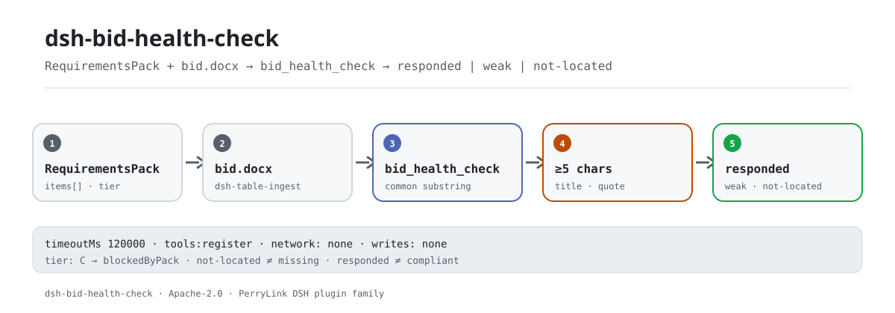

<div align="center">

<picture>
  <source media="(prefers-color-scheme: dark)" srcset="docs/assets/dsh-bid-health-check-flow-dark.svg">
  
</picture>

# dsh-bid-health-check

**把投标文件逐条对回要求清单——哪些看起来有响应、哪些可疑、哪些定位不到，一次说清。**

面向投标专员与标书编制人的纯本地核对工具：读一份 `RequirementsPack` 和一份 `.docx`，按词面重合给出三种状态；不判合规、不认定责任、不替代人工复核。

[安装](#三步上手) · [配置](#配置) · [FAQ](#faq) · [简体中文](README.md) · [English](README.en.md) · [Español](README.es.md) · [Português](README.pt.md) · [हिन्दी](README.hi.md)

[](LICENSE)
[](#兼容性)
[](https://www.npmjs.com/package/dsh-bid-health-check)
[](https://github.com/PerryLink/dsh-bid-health-check/actions/workflows/ci.yml)
[](#兼容性)

[](https://github.com/PerryLink/dsh-bid-health-check/stargazers)
[](https://www.npmjs.com/package/dsh-bid-health-check)
[](https://dshfind.com/plugins/PerryLink/dsh-bid-health-check?ref=badge)
[](https://securityscorecards.dev/viewer/?uri=github.com/PerryLink/dsh-bid-health-check)

```sh
dsh plugin --profile <name> add dsh-bid-health-check
```

</div>

<sub>社区插件，与 DeepSeek 官方无关。唯一仓库：<https://github.com/PerryLink/dsh-bid-health-check>。</sub>

## 它是什么

`dsh-bid-health-check` 读一份 `RequirementsPack`（由 `dsh-tender-requirements` 生成）和一份投标文件 `.docx`，逐条报告哪里看起来有响应、哪里匹配偏弱、哪里完全定位不到。

这个问题的诚实形态比「投标文件完整吗」窄得多：工具能定位到一段看起来在回应要求的文字，或者定位不到；它不能判断那一段是否真的满足要求，更不能断言定位不到就等于没写。报告把「定位不到」单独成组，并在最前面写明这一区别——因为把「定位不到」当成「没写」，会让人去重写一段本来已经写在表格、附件或另一种措辞里的内容。

输入只有两样：要求清单 `pack`（JSON，或含 `items` 数组的 YAML）与投标文件 `file`（`.docx`）。段落的读取交给 `dsh-table-ingest`；本版不读取投标文件里的表格。

## 三步上手

1. **安装**（三选一）：

   ```sh
   # git 通道（最新 main；会走 prepare 构建出 lib/）
   dsh plugin --profile web add github:PerryLink/dsh-bid-health-check
   # npm 通道（已发布版本，自带 lib/）
   dsh plugin --profile web add dsh-bid-health-check
   # tarball 通道：本仓库 pnpm run build && pnpm pack 后
   dsh plugin --profile web add ./dsh-bid-health-check-<version>.tgz
   ```

2. **最小配置**（默认即可用；只在需要时调超时）：

   ```yaml
   - insert:
       - id: dsh-bid-health-check
         name: dsh-bid-health-check
         config:
           timeoutMs: 120000
   ```

   规则库随包解析为 `rules/bid-health-check.yaml`，不是配置键；`timeoutMs` 是当前唯一的运行配置。

3. **验证已生效**：

   ```sh
   dsh --profile web --dump-config | grep 'dsh-bid-health-check'
   node samples/quickstart/run.mjs --check
   ```

   ```text
   bid_health_check: quickstart OK — output matches expected/result.json
   ```

   样例的期望结果（[`samples/quickstart/expected/result.json`](samples/quickstart/expected/result.json)）：`responded` 2 条、`weak` 3 条、`not-located` 6 条，另有 1 条被采购文件侧阻塞。首次运行截图：[`docs/assets/quickstart.png`](docs/assets/quickstart.png)；运行日志：[`docs/assets/quickstart.log`](docs/assets/quickstart.log)。

**卸载**：`dsh plugin --profile web remove dsh-bid-health-check`（或从 profile patch 删掉该行）。

## 核心能力

`dsh-bid-health-check` 在**要求清单与投标文件之间做词面定位**，并把每条要求放进三种状态之一：

- **三种状态，第三种不是「缺失」** —— `responded` / `weak` / `not-located`。`not-located` 只表示工具没找到；报告会原样写出「可能写在表格、附件或换了说法」。
- **5 字重合门槛** —— 标题与投标段落的最长公共子串至少 5 个字才算命中；4 个字太松（「投标截止时间」会靠「投标」命中）。
- **只与原文重合时降级** —— 标题重合不足 4 个字时回退到要求原文（quote）；仅与 quote 重合达到 6 个字会封顶 `weak`：和包含要求的条款共享文字，不等于要求被满足。
- **平局取长段** —— 同一个重合长度下取更长的段落：标题「第三章 投标保证金」和正文都会重复标签，正文才写着金额。
- **标题不算响应** —— 只匹配到一行短标题（不超过 12 字且没有句读）时降为 `weak`。
- **废标条款最高 weak** —— 废标条款是投标人要满足的条件，不是要回答的句子；没有投标文件会写「我方同意被拒收」，因此这类条款永远不评 `responded`。
- **C 队列透传** —— 采购文件侧就未能可信抽取的要求，报为被 `RequirementsPack` 阻塞（`blockedByPack`），不拿它去评投标人。
- **空清单拒绝执行** —— `items` 为空时直接报错；空清单会让任何投标文件都看起来「什么都没答」。
- **纯本地** —— 不联网、不调用模型、不写文件；只读 `pack` 与 `file` 两个路径。

### 它回答什么

- 哪些要求有一段看起来在回应的文字？
- 哪些匹配只是共享了一个短语，需要人去看？
- 哪些要求完全定位不到，需要人工核对？
- 哪些要求因为采购文件侧还没解决，根本没法核对？

### 匹配怎么算

对每条要求，工具测量它的标题与每个投标段落的最长公共子串；标题重合不足 4 个字时回退到要求原文（quote）。命中达到 5 个字才算找到了段落，平局取更长段落。只与 quote 重合且达到 6 个字的匹配最高 `weak`，标题式匹配也降为 `weak`，`reject-clause` 类别同样封顶 `weak`。命中的段落序号、段落摘录与字重合长度都会写进报告，读者可以自己判断这段是不是证据。

## 配置

所有可调项都是 Schemastery `Config` 字段（可从 `cordis.yml` 覆盖）。当前只有一个键：

| 键 | 默认值 | 含义 |
|---|---|---|
| `timeoutMs` | `120000` | 工具执行超时预算（毫秒）；超时由 DSH 工具层中止 |

<details>
<summary>完整配置表（1 个键）</summary>

| 键 | 默认值 | 含义 |
|---|---|---|
| `timeoutMs` | `120000` | 工具执行超时预算（毫秒）；超时由 DSH 工具层中止 |

</details>

规则库固定从包内 `rules/bid-health-check.yaml` 解析（工装按 `rules/<pack>.yaml` 定位），不是配置键；本包的 `rules` 为空——它是消费者，不是检查器，不引用条款作为判定依据，也不做合规判定。

profile patch 覆盖示例：

```yaml
- insert:
    - id: dsh-bid-health-check
      name: dsh-bid-health-check
      config:
        timeoutMs: 180000
```

## FAQ

<details>
<summary>会不会把投标文件上传？数据存在哪？</summary>

纯本地。工具只读调用方给出的 `pack` 与 `file` 两个路径，不联网、不调用模型、不写文件、不建索引；`package.json#dsh.demo` 也声明了 `network: false` 与 `writes: []`。注意报告文本会带上命中段落的前 200 字摘录，因此报告本身应按投标文件的敏感级别保管。

</details>

<details>
<summary>定位不到，是不是就等于没写？</summary>

不等于。要求可能写在表格、附件、扫描页里，或者换了一种说法；本工具只读 `.docx` 的段落，所以「定位不到」只说明本次没找到。报告会把这句话直接写在结果前面，并把这批要求单独列组，方便人工逐条核对。

</details>

<details>
<summary>有响应，是不是就等于满足要求？</summary>

不等于。工具给出的是一段「看起来在回应」的文字及其位置和字重合长度，是不是真的满足要求必须由人读那一段来判断。废标条款更严格：它是要满足的条件，不是要回答的句子，因此最高只给 `weak`。

</details>

<details>
<summary>会和其他插件抢工具名、事件或服务吗？</summary>

不会。它只注册 `bid_health_check` 一个工具，声明 `inject: ['tools']`；不提供 service key、不注册命令、不注册客户端 slot、不注册 `webServer` 前缀、不监听共享事件、不改全局对象。bundle patch 只 `insert` 自己一行。逐条论证见「与其他 DSH 插件的互操作性」。

</details>

<details>
<summary>性能开销多大？有没有基准数据？</summary>

纯字符串比较，无网络请求、无模型调用；开销约为要求数 × 段落数 × 段落长度（最长公共子串）。本仓没有公开 benchmark，因此这里不写准确率/召回率数字；`samples/quickstart` 的 11 条要求可以直接复跑，超时上限由 `timeoutMs` 控制。

</details>

<details>
<summary>装上了却看不到工具，或者结果为空怎么办？</summary>

先确认 `main` 指向 `lib/index.mjs` 且 `pnpm run build` 已产出；`dsh --profile <name> --dump-config | grep 'dsh-bid-health-check'` 应能看到对应行；peer 范围外需要显式豁免。规则没跑或结果为空时读报告里的 `warnings` 与 `blockedByPack`；空 `items` 会被直接拒绝，不会用空报告冒充「全部通过」。

</details>

## 安全边界

- **不做合规判定。** 报告只列材料内部能逐条指认的差异与定位结果，不做合规、法律、责任或废标结论。
- **定位不到 ≠ 没写。** 这是本工具最重要的边界：它只报告「本次没找到」，不推断「没写」。
- **有响应 ≠ 满足要求。** 命中的段落只是给人的指针，是否满足要求由人判断。
- **只读本地两份文件。** 不联网、不调用模型、不写盘；输入路径由调用方给出，工具不做目录扫描。
- **报告含原文摘录。** 命中段落会截取前 200 字写进报告；报告与投标文件同等敏感，请按组织的数据分级处理。
- **失败即报错。** 空 `items`、非法 JSON、条目缺 `id`、缺少 `pack`/`file` 参数都会抛错，不会用空结果冒充「全部通过」。

## 已知限制

- **只读段落。** 段落来自 `dsh-table-ingest`；本版不读投标文件里的表格、扫描页与附件，这些位置的响应完全不计入。
- **词面匹配，不懂同义改写。** 换一种说法写响应会被报成 `not-located`；反过来，共享短语也可能误命中，所以 `weak` 要人看。
- **5 字门槛是经验值。** 标题本身不足 5 个字的要求可能永远命中不了；长标题更稳，但仍需人工确认。
- **仅与 quote 重合的 5 字边界。** 当前实现在只与 quote 重合、且恰好 5 个字时仍可能给出 `responded`（`src/model.ts:249`）；5 字边界上的条目请按提示处理，人工复核。
- **定位到的是指针，不是结论。** 报告给的是段落序号、摘录与字重合长度，不判断是否满足要求。
- **C 队列无法核对。** 采购文件侧未解决的要求只报 `blockedByPack`，不评投标人。
- **只支持 `.docx`。** `file` 必须是 `.docx`；PDF、扫描件不在本版范围。
- **空清单拒绝执行。** 没有 `items` 或 `items: []` 都会报错。
- **无公开基准。** 不提供准确率/召回率数字；样例只验证管线与三态计数。

## 与其他 DSH 插件的互操作性

本插件只做一件事：注册 `bid_health_check` 工具。`src/index.ts` 声明 `inject: ['tools']`，`apply()` 只调用 `ctx.tools.register(...)` 并返回注销函数。

- **无工具名冲突。** 只注册 `bid_health_check` 一个工具 id；不占用其他裸名。
- **无服务键冲突。** 不提供 service key。
- **无命令冲突。** 不注册 `/` 命令。
- **无 slot / HTTP 冲突。** 不注册客户端 slot，也不注册 `webServer` 前缀。
- **无事件监听。** 不订阅 `agent/*`、`tools/*` 等共享事件，因此不存在监听器顺序问题。
- **无全局改写。** 不改原型、不改 `process.env`、不替换全局 fetch。
- **patch 层只 insert。** `cordis.patch.yml` 只插入自己一行，不覆写内置行的 `config`。

静态证据：`src/index.ts:12`（`inject`）、`src/index.ts:24-88`（唯一注册面）、`cordis.patch.yml:6-8`（唯一 patch 行）。

## 兼容性

| 维度 | 状态 |
|---|---|
| Harness | `package.json#engines.dsh`：`>=0.2.1-0 <0.3.0`；`@deepseek-ai/dsh-tools` peer：`>=0.1.2-rc.1 <0.2.0 \|\| >=0.2.0-0 <0.3.0` |
| Node | `^22.19.0 \|\| >=24.0.0` |
| 平台 | 任何 DSH 可运行处（纯 ESM；无原生代码、无网络、无模型调用） |
| 模型 | 文本模型即可；工具只做本地字符串比较，不需要额外模型能力 |

## 生态与质量

- [npm 包](https://www.npmjs.com/package/dsh-bid-health-check)（当前 `0.1.3`）
- [dshfind 插件页](https://dshfind.com/plugins/PerryLink/dsh-bid-health-check)（安装量与排名）
- [OpenSSF Scorecard 报告](https://securityscorecards.dev/viewer/?uri=github.com/PerryLink/dsh-bid-health-check)（由 [.github/workflows/scorecard.yml](.github/workflows/scorecard.yml) 驱动）
- [GitHub 仓库](https://github.com/PerryLink/dsh-bid-health-check)（唯一仓库）
- [生态实测知识库](https://perrylink.github.io/dsh-plugin-guide/)：插件开发指南 · 选型实测数据 · 维护取舍判据

## 开发

```sh
pnpm install
pnpm run typecheck
pnpm test
pnpm run build
pnpm run verify:self-contained
pnpm run check:lockfile
pnpm run check:readmes
pnpm run check:citations
node samples/quickstart/run.mjs --check
pnpm pack
```

构建产物是 `lib/`（`tsdown`）；发布前 `prepublishOnly` 会重跑 typecheck、测试、build、自包含校验、锁文件与 README 门禁。共享 kit 用 `node ../scripts/sync-shared.mjs dsh-bid-health-check` 同步。

配图由 [`scripts/gen-readme-assets.py`](scripts/gen-readme-assets.py) 程序化生成两张 SVG（浅色/深色），纯矢量、可重复执行。

| 路径 | 作用 |
|---|---|
| `src/index.ts` | 插件入口：注册 `bid_health_check` 工具、读取两份输入 |
| `src/config.ts` | Schemastery `Config`：`timeoutMs` |
| `src/model.ts` | 纯核对核心：`readPack`、`commonRun`、`check` |
| `src/report.ts` | Markdown 与 JSON 结果渲染 |
| `src/shared/` | 共享 kit（规则加载、报告形状、YAML 子集、表格工具）；复制进来，运行时自包含 |
| `rules/bid-health-check.yaml` | 规则库占位（`rules: []`）；本包是消费者，不执行检查 |
| `tests/` | vitest；三态、C 队列、废标条款与样例管线 |
| `samples/quickstart/` | 1 分钟试跑所需的 `pack.json`、`.docx` 与期望结果 |
| `scripts/` | 机械门禁（自包含、锁文件、README 同步、引用检查）与配图脚本 |
| `cordis.patch.yml` | bundle 层：只 `insert` 自己一行 |

Topics：`dsh`, `dsh-plugin`, `deepseek-harness`, `deepseek`, `cordis`, `bid`, `tender`, `health`, `response`

## 家族与致谢

本项目是 [PerryLink](https://github.com/PerryLink) 维护的 DeepSeek Harness 插件家族成员（全部 Apache-2.0）。如果这个插件帮到了你，**给个 star**——它不解锁任何功能，但会让下一个人更容易找到它。

- [@PerryLink](https://github.com/PerryLink) —— 创建者与维护者：`RequirementsPack` 逐条定位、三态报告、C 队列透传、废标条款封顶、五语文档。

<details>
<summary>展开全部插件</summary>

| 插件 | 状态 |
|---|---|
| **[dsh-aqua-input-check](https://github.com/PerryLink/dsh-aqua-input-check)** |  |
| **[dsh-archive-check](https://github.com/PerryLink/dsh-archive-check)** |  |
| **[dsh-auto-review](https://github.com/PerryLink/dsh-auto-review)** |  |
| **[dsh-autotier](https://github.com/PerryLink/dsh-autotier)** | 🧊 已冻结 — 见仓库 README |
| **[dsh-bid-ca-precheck](https://github.com/PerryLink/dsh-bid-ca-precheck)** |  |
| **[dsh-bid-qual-check](https://github.com/PerryLink/dsh-bid-qual-check)** |  |
| **[dsh-cert-mcp](https://github.com/PerryLink/dsh-cert-mcp)** | 🧊 已冻结 — 见仓库 README |
| **[dsh-checkpoint-rewind](https://github.com/PerryLink/dsh-checkpoint-rewind)** |  |
| **[dsh-click](https://github.com/PerryLink/dsh-click)** |  |
| **[dsh-composer-history](https://github.com/PerryLink/dsh-composer-history)** |  |
| **[dsh-contract-stance](https://github.com/PerryLink/dsh-contract-stance)** |  |
| **[dsh-customs-doc-check](https://github.com/PerryLink/dsh-customs-doc-check)** |  |
| **[dsh-data-quality](https://github.com/PerryLink/dsh-data-quality)** |  |
| **[dsh-demurrage-ledger](https://github.com/PerryLink/dsh-demurrage-ledger)** |  |
| **[dsh-doublecheck](https://github.com/PerryLink/dsh-doublecheck)** |  |
| **[dsh-drill-script-check](https://github.com/PerryLink/dsh-drill-script-check)** |  |
| **[dsh-eia-guide-check](https://github.com/PerryLink/dsh-eia-guide-check)** |  |
| **[dsh-emergency-plan](https://github.com/PerryLink/dsh-emergency-plan)** |  |
| **[dsh-essay-rubric-check](https://github.com/PerryLink/dsh-essay-rubric-check)** |  |
| **[dsh-evidence-check](https://github.com/PerryLink/dsh-evidence-check)** |  |
| **[dsh-export-ctl-check](https://github.com/PerryLink/dsh-export-ctl-check)** |  |
| **[dsh-fast](https://github.com/PerryLink/dsh-fast)** |  |
| **[dsh-fmea-table-check](https://github.com/PerryLink/dsh-fmea-table-check)** |  |
| **[dsh-forecast-penalty](https://github.com/PerryLink/dsh-forecast-penalty)** |  |
| **[dsh-fund-research](https://github.com/PerryLink/dsh-fund-research)** |  |
| **[dsh-github](https://github.com/PerryLink/dsh-github)** |  |
| **[dsh-gongwen-flow-check](https://github.com/PerryLink/dsh-gongwen-flow-check)** |  |
| **[dsh-gongwen-word-check](https://github.com/PerryLink/dsh-gongwen-word-check)** |  |
| **[dsh-guard-plan-qc](https://github.com/PerryLink/dsh-guard-plan-qc)** |  |
| **[dsh-hazchem-check](https://github.com/PerryLink/dsh-hazchem-check)** |  |
| **[dsh-hazplan-check](https://github.com/PerryLink/dsh-hazplan-check)** |  |
| **[dsh-hidden-risk-map](https://github.com/PerryLink/dsh-hidden-risk-map)** |  |
| **[dsh-hs-classify](https://github.com/PerryLink/dsh-hs-classify)** |  |
| **[dsh-icd-rule-check](https://github.com/PerryLink/dsh-icd-rule-check)** |  |
| **[dsh-industry-research](https://github.com/PerryLink/dsh-industry-research)** |  |
| **[dsh-lawcite-adapter](https://github.com/PerryLink/dsh-lawcite-adapter)** |  |
| **[dsh-laya](https://github.com/PerryLink/dsh-laya)** |  |
| **[dsh-lc-doc-check](https://github.com/PerryLink/dsh-lc-doc-check)** |  |
| **[dsh-learning-gap-check](https://github.com/PerryLink/dsh-learning-gap-check)** |  |
| **[dsh-library](https://github.com/PerryLink/dsh-library)** |  |
| **[dsh-local-ai](https://github.com/PerryLink/dsh-local-ai)** |  |
| **[dsh-lsp-actions](https://github.com/PerryLink/dsh-lsp-actions)** |  |
| **[dsh-mask](https://github.com/PerryLink/dsh-mask)** |  |
| **[dsh-mcp-panel](https://github.com/PerryLink/dsh-mcp-panel)** |  |
| **[dsh-medrec-qc](https://github.com/PerryLink/dsh-medrec-qc)** |  |
| **[dsh-memento](https://github.com/PerryLink/dsh-memento)** |  |
| **[dsh-nsfc-form-check](https://github.com/PerryLink/dsh-nsfc-form-check)** |  |
| **[dsh-nurse-record-check](https://github.com/PerryLink/dsh-nurse-record-check)** |  |
| **[dsh-observe](https://github.com/PerryLink/dsh-observe)** |  |
| **[dsh-origin-rvc-check](https://github.com/PerryLink/dsh-origin-rvc-check)** |  |
| **[dsh-ota-review-check](https://github.com/PerryLink/dsh-ota-review-check)** |  |
| **[dsh-output-styles](https://github.com/PerryLink/dsh-output-styles)** |  |
| **[dsh-paper-doc-adapter](https://github.com/PerryLink/dsh-paper-doc-adapter)** |  |
| **[dsh-permission-rules](https://github.com/PerryLink/dsh-permission-rules)** |  |
| **[dsh-permit-report-check](https://github.com/PerryLink/dsh-permit-report-check)** |  |
| **[dsh-pipeline-check](https://github.com/PerryLink/dsh-pipeline-check)** |  |
| **[dsh-pleading-draft](https://github.com/PerryLink/dsh-pleading-draft)** |  |
| **[dsh-plugin-doctor](https://github.com/PerryLink/dsh-plugin-doctor)** | 🚫 已退役（仓库已归档） |
| **[dsh-plugin-guide](https://github.com/PerryLink/dsh-plugin-guide)** |  |
| **[dsh-plugin-kit](https://github.com/PerryLink/dsh-plugin-kit)** | 🚫 已退役（仓库已归档） |
| **[dsh-plugin-upgrade](https://github.com/PerryLink/dsh-plugin-upgrade)** | 🚫 已退役（仓库已归档） |
| **[dsh-policy-brief-draft](https://github.com/PerryLink/dsh-policy-brief-draft)** |  |
| **[dsh-power-loss-split](https://github.com/PerryLink/dsh-power-loss-split)** |  |
| **[dsh-power-ticket-check](https://github.com/PerryLink/dsh-power-ticket-check)** |  |
| **[dsh-ppap-check](https://github.com/PerryLink/dsh-ppap-check)** |  |
| **[dsh-protest-deadline](https://github.com/PerryLink/dsh-protest-deadline)** |  |
| **[dsh-railway-window](https://github.com/PerryLink/dsh-railway-window)** |  |
| **[dsh-repair-order-qc](https://github.com/PerryLink/dsh-repair-order-qc)** |  |
| **[dsh-research-report](https://github.com/PerryLink/dsh-research-report)** |  |
| **[dsh-review-reply-check](https://github.com/PerryLink/dsh-review-reply-check)** |  |
| **[dsh-rulefile-check](https://github.com/PerryLink/dsh-rulefile-check)** |  |
| **[dsh-safety-brief-check](https://github.com/PerryLink/dsh-safety-brief-check)** |  |
| **[dsh-score](https://github.com/PerryLink/dsh-score)** |  |
| **[dsh-session-sync](https://github.com/PerryLink/dsh-session-sync)** |  |
| **[dsh-site-log-check](https://github.com/PerryLink/dsh-site-log-check)** |  |
| **[dsh-skill-pack-security](https://github.com/PerryLink/dsh-skill-pack-security)** |  |
| **[dsh-soe-decision-check](https://github.com/PerryLink/dsh-soe-decision-check)** |  |
| **[dsh-soilwater-check](https://github.com/PerryLink/dsh-soilwater-check)** |  |
| **[dsh-sop-sync-check](https://github.com/PerryLink/dsh-sop-sync-check)** |  |
| **[dsh-spc-gbt-adapter](https://github.com/PerryLink/dsh-spc-gbt-adapter)** |  |
| **[dsh-talk](https://github.com/PerryLink/dsh-talk)** |  |
| **[dsh-tender-extract](https://github.com/PerryLink/dsh-tender-extract)** |  |
| **[dsh-tender-matrix](https://github.com/PerryLink/dsh-tender-matrix)** |  |
| **[dsh-test-drive](https://github.com/PerryLink/dsh-test-drive)** |  |
| **[dsh-ticktick](https://github.com/PerryLink/dsh-ticktick)** | 🚫 已退役（仓库已归档） |
| **[dsh-translate](https://github.com/PerryLink/dsh-translate)** |  |
| **[dsh-warranty-calc](https://github.com/PerryLink/dsh-warranty-calc)** |  |
| **[dsh-budget](https://github.com/PerryLink/dsh-budget)** | 🧊 已冻结 — 见仓库 README |
| **[dsh-claude-move](https://github.com/PerryLink/dsh-claude-move)** | 🧊 已冻结 — 见仓库 README |
| **[dsh-defend](https://github.com/PerryLink/dsh-defend)** | 🧊 已冻结 — 见仓库 README |
| **[dsh-draw](https://github.com/PerryLink/dsh-draw)** | 🧊 已冻结 — 见仓库 README |
| **[dsh-reach](https://github.com/PerryLink/dsh-reach)** | 🧊 已冻结 — 见仓库 README |
| **[dsh-background-agents](https://github.com/PerryLink/dsh-background-agents)** | 🚫 已退役（仓库已归档） |
| **[dsh-session-pin](https://github.com/PerryLink/dsh-session-pin)** | 🚫 已退役（仓库已归档） |
| **[dsh-team-rooms](https://github.com/PerryLink/dsh-team-rooms)** | 🚫 已退役（仓库已归档） |

</details>

## License

[LICENSE](LICENSE)（Apache License 2.0）© 2026 dsh-bid-health-check contributors

<p align="center"><sub>Apache-2.0 · 社区插件，与 DeepSeek 无关。</sub></p>
