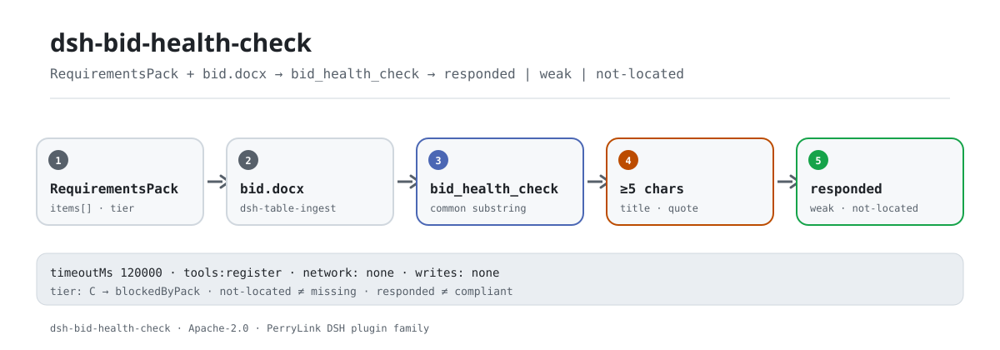

<div align="center">

<picture>
  <source media="(prefers-color-scheme: dark)" srcset="docs/assets/dsh-bid-health-check-flow-dark.svg">
  
</picture>

# dsh-bid-health-check

**Confronte uma proposta com a lista de requisitos, item a item: o que parece respondido, o que é fraco e o que não pôde ser localizado.**

Um verificador puramente local para redatores de propostas: lê um `RequirementsPack` e um `.docx`, informa três estados no nível do texto e não emite juízo de conformidade, responsabilidade ou substituição da revisão humana.

[Instalação](#instalação-em-três-passos) · [Configuração](#configuração) · [FAQ](#faq) · [简体中文](README.md) · [English](README.en.md) · [Español](README.es.md) · [Português](README.pt.md) · [हिन्दी](README.hi.md)

[](LICENSE)
[](#compatibilidade)
[](https://www.npmjs.com/package/dsh-bid-health-check)
[](https://github.com/PerryLink/dsh-bid-health-check/actions/workflows/ci.yml)
[](#compatibilidade)

[](https://github.com/PerryLink/dsh-bid-health-check/stargazers)
[](https://www.npmjs.com/package/dsh-bid-health-check)
[](https://dshfind.com/plugins/PerryLink/dsh-bid-health-check?ref=badge)
[](https://securityscorecards.dev/viewer/?uri=github.com/PerryLink/dsh-bid-health-check)

```sh
dsh plugin --profile <name> add dsh-bid-health-check
```

</div>

<sub>Plugin da comunidade, sem afiliação com a DeepSeek. Repositório canônico: <https://github.com/PerryLink/dsh-bid-health-check>.</sub>

## O que é

O `dsh-bid-health-check` lê um `RequirementsPack` (gerado pelo `dsh-tender-requirements`) e um documento de proposta `.docx`, e informa requisito por requisito onde a proposta parece responder, onde a correspondência é fraca e onde nada foi localizado.

A forma honesta dessa pergunta é bem mais estreita que «a proposta está completa?»: a ferramenta consegue localizar um parágrafo que parece responder, ou não localizar nenhum. Ela não sabe se o parágrafo localizado realmente satisfaz o requisito, e muito menos pode concluir que um requisito não localizado está sem resposta. O relatório mantém «não localizado» em um grupo próprio e enuncia essa distinção primeiro — tratar «não localizado» como «ausente» é como um licitante acaba reescrevendo uma seção que já estava lá, em uma tabela, um anexo ou com outras palavras.

Há exatamente duas entradas: a lista de requisitos `pack` (JSON, ou YAML com um array `items`) e a proposta `file` (`.docx`). Os parágrafos são lidos pelo `dsh-table-ingest`; esta versão não lê as tabelas dentro da proposta.

## Instalação em três passos

1. **Instalar** (escolha um canal):

   ```sh
   # canal git (main mais recente; o script prepare constrói lib/)
   dsh plugin --profile web add github:PerryLink/dsh-bid-health-check
   # canal npm (versão publicada, já inclui lib/)
   dsh plugin --profile web add dsh-bid-health-check
   # canal tarball: após pnpm run build && pnpm pack neste repositório
   dsh plugin --profile web add ./dsh-bid-health-check-<version>.tgz
   ```

2. **Configuração mínima** (os padrões bastam; ajuste o tempo limite só se precisar):

   ```yaml
   - insert:
       - id: dsh-bid-health-check
         name: dsh-bid-health-check
         config:
           timeoutMs: 120000
   ```

   O pacote de regras é resolvido de dentro do pacote em `rules/bid-health-check.yaml`; não é uma chave de configuração. `timeoutMs` é hoje o único ajuste de execução.

3. **Verificar que monta**:

   ```sh
   dsh --profile web --dump-config | grep 'dsh-bid-health-check'
   node samples/quickstart/run.mjs --check
   ```

   ```text
   bid_health_check: quickstart OK — output matches expected/result.json
   ```

   Resultado esperado de [`samples/quickstart/expected/result.json`](samples/quickstart/expected/result.json): 2 `responded`, 3 `weak`, 6 `not-located`, mais 1 bloqueado pelo edital. Captura da primeira execução: [`docs/assets/quickstart.png`](docs/assets/quickstart.png); registro: [`docs/assets/quickstart.log`](docs/assets/quickstart.log).

**Desinstalar**: `dsh plugin --profile web remove dsh-bid-health-check` (ou remova a linha do patch do perfil).

## Capacidades principais

O `dsh-bid-health-check` faz **localização textual entre a lista de requisitos e a proposta**, e coloca cada requisito em um de três estados:

- **Três estados, e o terceiro não é «ausente»** — `responded` / `weak` / `not-located`. `not-located` significa apenas que a ferramenta não encontrou; o relatório diz com todas as letras que a proposta pode responder em uma tabela, um anexo ou com outras palavras.
- **Limite de cinco caracteres** — o título precisa compartilhar uma subcadeia comum de pelo menos cinco caracteres com um parágrafo da proposta. Quatro é frouxo demais (「投标截止时间」 casava por 「投标」).
- **Correspondência só na citação é rebaixada** — se a coincidência do título for menor que quatro caracteres, recorre-se à citação do requisito; uma coincidência só de citação de seis caracteres ou mais fica em `weak`, porque compartilhar texto com a cláusula que contém o requisito não prova que ele foi cumprido.
- **Empates vão para o parágrafo mais longo** — um título como 「第三章 投标保证金」 repete o rótulo, enquanto o corpo diz o valor.
- **Título não é resposta** — uma coincidência que é só um título curto (no máximo 12 caracteres e sem pontuação de frase) cai para `weak`.
- **Cláusulas de rejeição ficam em `weak`** — são uma condição que o licitante deve cumprir, não uma frase a responder; nenhuma proposta diz 「我方同意被拒收」, então nunca são pontuadas como `responded`.
- **A fila C passa adiante** — um requisito que o lado do edital não conseguiu extrair de forma confiável é informado como bloqueado pelo `RequirementsPack` (`blockedByPack`), não é avaliado contra o licitante.
- **Pacote vazio é recusado** — `items: []` gera erro; uma lista vazia faria toda proposta parecer que não responde nada.
- **Puramente local** — sem rede, sem chamadas a modelo, sem gravação em disco; lê apenas os caminhos `pack` e `file` recebidos.

### O que responde

- Quais requisitos têm um parágrafo que plausivelmente os responde?
- Quais correspondências são só uma frase compartilhada e precisam de uma pessoa?
- Quais requisitos não têm resposta localizada e exigem conferência manual?
- Quais requisitos não podem ser verificados porque o edital ainda está sem solução?

### Como a correspondência funciona

Para cada requisito, a ferramenta mede a subcadeia comum mais longa entre seu título e cada parágrafo da proposta; se a coincidência do título ficar abaixo de quatro caracteres, recorre à citação do requisito. Só conta a partir de cinco caracteres e, em empate, vence o parágrafo mais longo. Correspondências só de citação de seis caracteres ou mais ficam em `weak`, as de título caem para `weak` e a categoria `reject-clause` também fica em `weak`. O ordinal do parágrafo, um trecho e o comprimento da coincidência vão para o relatório, para o leitor julgar se aquele parágrafo é evidência.

## Configuração

Todos os ajustes são campos de `Config` do Schemastery (sobrescrevíveis pelo `cordis.yml`). Hoje há uma única chave:

| Chave | Padrão | Significado |
|---|---|---|
| `timeoutMs` | `120000` | Orçamento de tempo de execução da ferramenta em milissegundos; a camada de ferramentas do DSH aborta ao vencer |

<details>
<summary>Tabela completa de configuração (1 chave)</summary>

| Chave | Padrão | Significado |
|---|---|---|
| `timeoutMs` | `120000` | Orçamento de tempo de execução da ferramenta em milissegundos; a camada de ferramentas do DSH aborta ao vencer |

</details>

O pacote de regras é sempre resolvido no pacote em `rules/bid-health-check.yaml` (as ferramentas localizam `rules/<pack>.yaml`); não é uma chave de configuração. A lista `rules` deste pacote está vazia: ele é um consumidor, não um verificador; não cita cláusulas como base de um achado nem emite juízo de conformidade.

Exemplo de sobrescrita no patch do perfil:

```yaml
- insert:
    - id: dsh-bid-health-check
      name: dsh-bid-health-check
      config:
        timeoutMs: 180000
```

## FAQ

<details>
<summary>Ele envia a proposta? Onde os dados ficam?</summary>

Puramente local. A ferramenta lê apenas os caminhos `pack` e `file` recebidos; não faz requisições de rede, não chama modelo, não grava arquivos nem cria índices. O `package.json#dsh.demo` também declara `network: false` e `writes: []`. Atenção: o relatório cita até 200 caracteres dos parágrafos coincidentes, então o próprio relatório deve ser tratado com a sensibilidade da proposta.

</details>

<details>
<summary>«Não localizado» significa que não foi respondido?</summary>

Não. O requisito pode estar respondido em uma tabela, um anexo, uma página digitalizada ou com outras palavras; esta ferramenta lê apenas parágrafos de `.docx`, então «não localizado» significa só que esta execução não encontrou. O relatório diz isso antes dos resultados e agrupa esses requisitos à parte para conferência manual.

</details>

<details>
<summary>«Respondido» significa que o requisito foi cumprido?</summary>

Não. A ferramenta devolve um parágrafo que parece responder, com posição e comprimento da coincidência; se ele realmente satisfaz o requisito é uma pessoa que decide lendo. Cláusulas de rejeição são ainda mais estritas: são condições a cumprir, não frases a responder, então ficam em `weak`.

</details>

<details>
<summary>Ele disputa nomes de ferramenta, eventos ou serviços com outros plugins?</summary>

Não. Registra uma única ferramenta, `bid_health_check`, e declara `inject: ['tools']`; não oferece service key, não registra comandos, slots de cliente, prefixos `webServer`, não escuta eventos compartilhados e não altera globais. O patch do bundle apenas `insert`a sua própria linha. A argumentação ponto a ponto está em «Interoperabilidade com outros plugins DSH».

</details>

<details>
<summary>Qual é o custo de desempenho? Há benchmark?</summary>

Comparação pura de strings — sem rede, sem chamadas a modelo — com custo proporcional a requisitos × parágrafos × comprimento do parágrafo (subcadeia comum mais longa). Este repositório não publica benchmark, então não há números de precisão/recall aqui; os 11 requisitos de `samples/quickstart` podem ser reexecutados, e `timeoutMs` limita a execução.

</details>

<details>
<summary>Instala, mas a ferramenta não aparece, ou o resultado está vazio. E agora?</summary>

Confira primeiro se `main` aponta para `lib/index.mjs` e se `pnpm run build` o gerou; `dsh --profile <name> --dump-config | grep 'dsh-bid-health-check'` deve mostrar a linha; fora do intervalo de peers, conceda uma isenção explícita. Se nada rodou ou o resultado está vazio, leia `warnings` e `blockedByPack` no relatório; um `items` vazio é recusado em vez de ser apresentado como «tudo certo».

</details>

## Limites de segurança

- **Sem juízo de conformidade.** O relatório lista apenas diferenças e resultados de localização que consegue apontar dentro do material; não emite veredicto de conformidade, legal, de responsabilidade ou de rejeição.
- **Não localizado ≠ não escrito.** É o limite mais importante: informa «não encontrado desta vez» e não infere «ausente».
- **Respondido ≠ cumprido.** O parágrafo coincidente é uma pista para uma pessoa; se satisfaz o requisito é um julgamento humano.
- **Lê apenas dois arquivos locais.** Sem rede, sem chamadas a modelo, sem gravações; o chamador fornece os dois caminhos e a ferramenta não varre diretórios.
- **O relatório contém trechos.** Até 200 caracteres de um parágrafo coincidente entram no relatório; trate-o com a mesma sensibilidade da proposta.
- **Falha em voz alta.** `items` vazio, JSON inválido, `id` ausente ou falta de `pack`/`file` geram erro em vez de um resultado vazio que poderia ser lido como «tudo certo».

## Limitações conhecidas

- **Apenas parágrafos.** Os parágrafos vêm do `dsh-table-ingest`; esta versão não lê tabelas, páginas digitalizadas nem anexos da proposta, então respostas ali não contam.
- **Correspondência textual, sem entender paráfrase.** Uma resposta com outras palavras é informada como `not-located`; por outro lado, uma frase compartilhada pode gerar falso positivo, por isso `weak` precisa de olho humano.
- **O limite de cinco caracteres é empírico.** Um requisito cujo título tenha menos de cinco caracteres pode nunca casar; títulos longos são mais estáveis, mas ainda exigem confirmação.
- **A borda de cinco caracteres só de citação.** Na implementação atual, uma coincidência só de citação de exatamente cinco caracteres ainda pode ser pontuada como `responded` (`src/model.ts:249`); trate esses itens como pistas e revise à mão.
- **O parágrafo localizado é uma pista, não um veredicto.** O relatório dá o ordinal, um trecho e o comprimento da coincidência; não decide se o requisito foi cumprido.
- **A fila C não pode ser verificada.** Um requisito sem solução no edital é informado apenas como `blockedByPack`, nunca avaliado contra o licitante.
- **Apenas `.docx`.** `file` precisa ser um `.docx`; PDF e digitalizações ficam fora desta versão.
- **Pacote vazio é recusado.** Falta de `items` ou `items: []` geram erro.
- **Sem benchmark público.** Não há números de precisão/recall; a amostra só verifica o fluxo e as contagens dos três estados.

## Interoperabilidade com outros plugins DSH

Este plugin faz uma coisa só: registrar a ferramenta `bid_health_check`. O `src/index.ts` declara `inject: ['tools']`, e `apply()` apenas chama `ctx.tools.register(...)` e devolve a função de cancelamento.

- **Sem colisão de nome de ferramenta.** Um único id, `bid_health_check`; nenhum outro nome nu é ocupado.
- **Sem colisão de service key.** Não oferece nenhuma service key.
- **Sem colisão de comando.** Não registra comandos `/`.
- **Sem colisão de slot ou HTTP.** Não registra slots de cliente nem prefixos `webServer`.
- **Sem listeners de evento.** Não assina eventos compartilhados `agent/*` ou `tools/*`, então não há questão de ordem de listeners.
- **Sem mutação global.** Não altera protótipos, não reescreve `process.env` nem substitui o fetch global.
- **A camada patch só insere.** O `cordis.patch.yml` insere sua própria linha e nunca sobrescreve o `config` de uma linha embutida.

Evidência estática: `src/index.ts:12` (`inject`), `src/index.ts:24-88` (a única superfície de registro), `cordis.patch.yml:6-8` (a única linha de patch).

## Compatibilidade

| Superfície | Estado |
|---|---|
| Harness | `package.json#engines.dsh`: `>=0.2.1-0 <0.3.0`; peer de `@deepseek-ai/dsh-tools`: `>=0.1.2-rc.1 <0.2.0 \|\| >=0.2.0-0 <0.3.0` |
| Node | `^22.19.0 \|\| >=24.0.0` |
| Plataformas | Onde o DSH rodar (ESM puro; sem código nativo, sem rede, sem chamadas a modelo) |
| Modelo | Qualquer modelo de texto; a ferramenta só compara strings locais e não exige capacidade extra |

## Ecossistema e qualidade

- [Pacote npm](https://www.npmjs.com/package/dsh-bid-health-check) (atualmente `0.1.3`)
- [Página no dshfind](https://dshfind.com/plugins/PerryLink/dsh-bid-health-check) (instalações e ranking)
- [Relatório OpenSSF Scorecard](https://securityscorecards.dev/viewer/?uri=github.com/PerryLink/dsh-bid-health-check) (gerado por [.github/workflows/scorecard.yml](.github/workflows/scorecard.yml))
- [Repositório GitHub](https://github.com/PerryLink/dsh-bid-health-check) (canônico)
- [Base de conhecimento do ecossistema](https://perrylink.github.io/dsh-plugin-guide/): guia de desenvolvimento · dados de seleção · critérios de manutenção

## Desenvolvimento

```sh
pnpm install
pnpm run typecheck
pnpm test
pnpm run build
pnpm run verify:self-contained
pnpm run check:lockfile
pnpm run check:readmes
pnpm run check:citations
node samples/quickstart/run.mjs --check
pnpm pack
```

A saída de build é `lib/` (`tsdown`); o `prepublishOnly` reexecuta typecheck, testes, build, a porta de autossuficiência, a do lockfile e a de README. O kit compartilhado é sincronizado com `node ../scripts/sync-shared.mjs dsh-bid-health-check`.

As imagens do README são geradas por [`scripts/gen-readme-assets.py`](scripts/gen-readme-assets.py): dois SVGs vetoriais (claro/escuro), seguros para reexecutar.

| Caminho | Papel |
|---|---|
| `src/index.ts` | Entrada do plugin: registra a ferramenta `bid_health_check` e lê as duas entradas |
| `src/config.ts` | `Config` do Schemastery: `timeoutMs` |
| `src/model.ts` | Núcleo puro: `readPack`, `commonRun`, `check` |
| `src/report.ts` | Renderização do resultado em Markdown e JSON |
| `src/shared/` | Kit compartilhado (carregamento de regras, forma do relatório, subconjunto YAML, utilitários de tabela); copiado para o pacote ser autossuficiente |
| `rules/bid-health-check.yaml` | Placeholder do pacote de regras (`rules: []`); este pacote é consumidor e não executa verificações |
| `tests/` | vitest; três estados, fila C, cláusulas de rejeição e o fluxo da amostra |
| `samples/quickstart/` | A execução de um minuto: `pack.json`, `.docx` e o resultado esperado |
| `scripts/` | Portas mecânicas (autossuficiência, lockfile, sincronia de README, citações) e o gerador de imagens |
| `cordis.patch.yml` | Camada bundle: apenas `insert`a sua própria linha |

Topics: `dsh`, `dsh-plugin`, `deepseek-harness`, `deepseek`, `cordis`, `bid`, `tender`, `health`, `response`

## Família e agradecimentos

Este projeto faz parte da família de plugins de DeepSeek Harness da [PerryLink](https://github.com/PerryLink) (todos Apache-2.0). Se ele for útil, **uma estrela ajuda a próxima pessoa a encontrá-lo**; nada é desbloqueado por isso.

- [@PerryLink](https://github.com/PerryLink) — criador e mantenedor: o localizador por item do `RequirementsPack`, o relatório de três estados, o repasse da fila C, o limite das cláusulas de rejeição e a documentação em cinco idiomas.

<details>
<summary>Expandir todos os plugins</summary>

| Plugin | Estado |
|---|---|
| **[dsh-aqua-input-check](https://github.com/PerryLink/dsh-aqua-input-check)** |  |
| **[dsh-archive-check](https://github.com/PerryLink/dsh-archive-check)** |  |
| **[dsh-auto-review](https://github.com/PerryLink/dsh-auto-review)** |  |
| **[dsh-autotier](https://github.com/PerryLink/dsh-autotier)** | 🧊 CONGELADO — ver o README do repo |
| **[dsh-bid-ca-precheck](https://github.com/PerryLink/dsh-bid-ca-precheck)** |  |
| **[dsh-bid-qual-check](https://github.com/PerryLink/dsh-bid-qual-check)** |  |
| **[dsh-cert-mcp](https://github.com/PerryLink/dsh-cert-mcp)** | 🧊 CONGELADO — ver o README do repo |
| **[dsh-checkpoint-rewind](https://github.com/PerryLink/dsh-checkpoint-rewind)** |  |
| **[dsh-click](https://github.com/PerryLink/dsh-click)** |  |
| **[dsh-composer-history](https://github.com/PerryLink/dsh-composer-history)** |  |
| **[dsh-contract-stance](https://github.com/PerryLink/dsh-contract-stance)** |  |
| **[dsh-customs-doc-check](https://github.com/PerryLink/dsh-customs-doc-check)** |  |
| **[dsh-data-quality](https://github.com/PerryLink/dsh-data-quality)** |  |
| **[dsh-demurrage-ledger](https://github.com/PerryLink/dsh-demurrage-ledger)** |  |
| **[dsh-doublecheck](https://github.com/PerryLink/dsh-doublecheck)** |  |
| **[dsh-drill-script-check](https://github.com/PerryLink/dsh-drill-script-check)** |  |
| **[dsh-eia-guide-check](https://github.com/PerryLink/dsh-eia-guide-check)** |  |
| **[dsh-emergency-plan](https://github.com/PerryLink/dsh-emergency-plan)** |  |
| **[dsh-essay-rubric-check](https://github.com/PerryLink/dsh-essay-rubric-check)** |  |
| **[dsh-evidence-check](https://github.com/PerryLink/dsh-evidence-check)** |  |
| **[dsh-export-ctl-check](https://github.com/PerryLink/dsh-export-ctl-check)** |  |
| **[dsh-fast](https://github.com/PerryLink/dsh-fast)** |  |
| **[dsh-fmea-table-check](https://github.com/PerryLink/dsh-fmea-table-check)** |  |
| **[dsh-forecast-penalty](https://github.com/PerryLink/dsh-forecast-penalty)** |  |
| **[dsh-fund-research](https://github.com/PerryLink/dsh-fund-research)** |  |
| **[dsh-github](https://github.com/PerryLink/dsh-github)** |  |
| **[dsh-gongwen-flow-check](https://github.com/PerryLink/dsh-gongwen-flow-check)** |  |
| **[dsh-gongwen-word-check](https://github.com/PerryLink/dsh-gongwen-word-check)** |  |
| **[dsh-guard-plan-qc](https://github.com/PerryLink/dsh-guard-plan-qc)** |  |
| **[dsh-hazchem-check](https://github.com/PerryLink/dsh-hazchem-check)** |  |
| **[dsh-hazplan-check](https://github.com/PerryLink/dsh-hazplan-check)** |  |
| **[dsh-hidden-risk-map](https://github.com/PerryLink/dsh-hidden-risk-map)** |  |
| **[dsh-hs-classify](https://github.com/PerryLink/dsh-hs-classify)** |  |
| **[dsh-icd-rule-check](https://github.com/PerryLink/dsh-icd-rule-check)** |  |
| **[dsh-industry-research](https://github.com/PerryLink/dsh-industry-research)** |  |
| **[dsh-lawcite-adapter](https://github.com/PerryLink/dsh-lawcite-adapter)** |  |
| **[dsh-laya](https://github.com/PerryLink/dsh-laya)** |  |
| **[dsh-lc-doc-check](https://github.com/PerryLink/dsh-lc-doc-check)** |  |
| **[dsh-learning-gap-check](https://github.com/PerryLink/dsh-learning-gap-check)** |  |
| **[dsh-library](https://github.com/PerryLink/dsh-library)** |  |
| **[dsh-local-ai](https://github.com/PerryLink/dsh-local-ai)** |  |
| **[dsh-lsp-actions](https://github.com/PerryLink/dsh-lsp-actions)** |  |
| **[dsh-mask](https://github.com/PerryLink/dsh-mask)** |  |
| **[dsh-mcp-panel](https://github.com/PerryLink/dsh-mcp-panel)** |  |
| **[dsh-medrec-qc](https://github.com/PerryLink/dsh-medrec-qc)** |  |
| **[dsh-memento](https://github.com/PerryLink/dsh-memento)** |  |
| **[dsh-nsfc-form-check](https://github.com/PerryLink/dsh-nsfc-form-check)** |  |
| **[dsh-nurse-record-check](https://github.com/PerryLink/dsh-nurse-record-check)** |  |
| **[dsh-observe](https://github.com/PerryLink/dsh-observe)** |  |
| **[dsh-origin-rvc-check](https://github.com/PerryLink/dsh-origin-rvc-check)** |  |
| **[dsh-ota-review-check](https://github.com/PerryLink/dsh-ota-review-check)** |  |
| **[dsh-output-styles](https://github.com/PerryLink/dsh-output-styles)** |  |
| **[dsh-paper-doc-adapter](https://github.com/PerryLink/dsh-paper-doc-adapter)** |  |
| **[dsh-permission-rules](https://github.com/PerryLink/dsh-permission-rules)** |  |
| **[dsh-permit-report-check](https://github.com/PerryLink/dsh-permit-report-check)** |  |
| **[dsh-pipeline-check](https://github.com/PerryLink/dsh-pipeline-check)** |  |
| **[dsh-pleading-draft](https://github.com/PerryLink/dsh-pleading-draft)** |  |
| **[dsh-plugin-doctor](https://github.com/PerryLink/dsh-plugin-doctor)** | 🚫 APOSENTADO (repo arquivado) |
| **[dsh-plugin-guide](https://github.com/PerryLink/dsh-plugin-guide)** |  |
| **[dsh-plugin-kit](https://github.com/PerryLink/dsh-plugin-kit)** | 🚫 APOSENTADO (repo arquivado) |
| **[dsh-plugin-upgrade](https://github.com/PerryLink/dsh-plugin-upgrade)** | 🚫 APOSENTADO (repo arquivado) |
| **[dsh-policy-brief-draft](https://github.com/PerryLink/dsh-policy-brief-draft)** |  |
| **[dsh-power-loss-split](https://github.com/PerryLink/dsh-power-loss-split)** |  |
| **[dsh-power-ticket-check](https://github.com/PerryLink/dsh-power-ticket-check)** |  |
| **[dsh-ppap-check](https://github.com/PerryLink/dsh-ppap-check)** |  |
| **[dsh-protest-deadline](https://github.com/PerryLink/dsh-protest-deadline)** |  |
| **[dsh-railway-window](https://github.com/PerryLink/dsh-railway-window)** |  |
| **[dsh-repair-order-qc](https://github.com/PerryLink/dsh-repair-order-qc)** |  |
| **[dsh-research-report](https://github.com/PerryLink/dsh-research-report)** |  |
| **[dsh-review-reply-check](https://github.com/PerryLink/dsh-review-reply-check)** |  |
| **[dsh-rulefile-check](https://github.com/PerryLink/dsh-rulefile-check)** |  |
| **[dsh-safety-brief-check](https://github.com/PerryLink/dsh-safety-brief-check)** |  |
| **[dsh-score](https://github.com/PerryLink/dsh-score)** |  |
| **[dsh-session-sync](https://github.com/PerryLink/dsh-session-sync)** |  |
| **[dsh-site-log-check](https://github.com/PerryLink/dsh-site-log-check)** |  |
| **[dsh-skill-pack-security](https://github.com/PerryLink/dsh-skill-pack-security)** |  |
| **[dsh-soe-decision-check](https://github.com/PerryLink/dsh-soe-decision-check)** |  |
| **[dsh-soilwater-check](https://github.com/PerryLink/dsh-soilwater-check)** |  |
| **[dsh-sop-sync-check](https://github.com/PerryLink/dsh-sop-sync-check)** |  |
| **[dsh-spc-gbt-adapter](https://github.com/PerryLink/dsh-spc-gbt-adapter)** |  |
| **[dsh-talk](https://github.com/PerryLink/dsh-talk)** |  |
| **[dsh-tender-extract](https://github.com/PerryLink/dsh-tender-extract)** |  |
| **[dsh-tender-matrix](https://github.com/PerryLink/dsh-tender-matrix)** |  |
| **[dsh-test-drive](https://github.com/PerryLink/dsh-test-drive)** |  |
| **[dsh-ticktick](https://github.com/PerryLink/dsh-ticktick)** | 🚫 APOSENTADO (repo arquivado) |
| **[dsh-translate](https://github.com/PerryLink/dsh-translate)** |  |
| **[dsh-warranty-calc](https://github.com/PerryLink/dsh-warranty-calc)** |  |
| **[dsh-budget](https://github.com/PerryLink/dsh-budget)** | 🧊 CONGELADO — ver o README do repo |
| **[dsh-claude-move](https://github.com/PerryLink/dsh-claude-move)** | 🧊 CONGELADO — ver o README do repo |
| **[dsh-defend](https://github.com/PerryLink/dsh-defend)** | 🧊 CONGELADO — ver o README do repo |
| **[dsh-draw](https://github.com/PerryLink/dsh-draw)** | 🧊 CONGELADO — ver o README do repo |
| **[dsh-reach](https://github.com/PerryLink/dsh-reach)** | 🧊 CONGELADO — ver o README do repo |
| **[dsh-background-agents](https://github.com/PerryLink/dsh-background-agents)** | 🚫 APOSENTADO (repo arquivado) |
| **[dsh-session-pin](https://github.com/PerryLink/dsh-session-pin)** | 🚫 APOSENTADO (repo arquivado) |
| **[dsh-team-rooms](https://github.com/PerryLink/dsh-team-rooms)** | 🚫 APOSENTADO (repo arquivado) |

</details>

## Licença

[LICENSE](LICENSE) (Apache License 2.0) © 2026 dsh-bid-health-check contributors

<p align="center"><sub>Apache-2.0 · Plugin da comunidade, sem afiliação com a DeepSeek.</sub></p>
